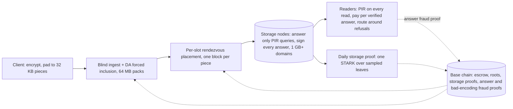

# Holoweave Design Doc

Oct 18, 2026 · @qingpinghe

## Overview and goals

Holoweave is a decentralized store built against **shadowbanning and narrative control**: the quiet, selective suppression of one person's project, post or archive so that it simply stops being found and nobody notices. Files are paid for once and kept for a fixed term (default 10 years). Holoweave does not stop a censor willing to take down most of the network; it makes sure that removing one chosen file costs about as much as that.

**The problem.** Most real censorship is not a ban. A personal project drops out of search results, a host quietly stops serving one file, a link starts timing out for some readers. Each act is small, deniable and invisible to everyone except the author. It works because the censor can target one file precisely while nothing else is affected.

**The goal: no cheap, selective suppression.** Holoweave attacks both things a shadowban needs:

- **Removing one file takes most of the network.** Files are erasure-coded together in 64 MB packs, and every piece of a pack sits in its own stripe on its own random holders. Making one chosen file unreadable means destroying more than half of its pack's 4,096 stripes, which takes about two-thirds of all stake: the same stake that could black out most of the network anyway.
- **Refusing doesn't work.** Every read is a PIR query, so a node never learns which record a query is for. Nodes sign every answer, so a node that deletes or corrupts a chosen file's record hands that file's readers wrong answers they can prove, and it loses its bond; since it can't tell which queries are theirs, it can't avoid them. Its only unpunished option is refusing, which can't single out a record, and readers route around refusals to other holders. Below the threshold a node or coalition can make a chosen file slower or costlier for some readers, never unavailable.

**Guarantees**

1. **Availability (mathematical):** a coalition below about 66% of the network's stake has a negligible chance (under 10^-18) of making a chosen file unreadable. Per file, the chance stays below 10^-18; over all files a union bound applies.
2. **Record privacy (mathematical):** a node's view of a query is independent of which record in the domain it targets, whatever else it knows about the reader.
3. **Blind storage:** nodes can't identify a file at upload, inclusion or assignment, and every stored byte is ciphertext. Once a file's address is public, anyone, including its holders, can compute where its pieces are; what protects it then is placement (guarantee 1) and routing around refusals (guarantee 4).
4. **Refusals routed around, wrong answers slashed:** a refused or wrong answer costs the reader about 32 extra queries for that block, sent in parallel, and the node earns nothing for it. Answers are signed, so a wrong answer to a well-formed query is provable and costs the node its bond.
5. **Private reads:** every read is a PIR query, so no node ever sees which record is wanted. Nodes do see who is asking (there is no anonymity layer).
6. **Fixed-term economics and clean expiry:** prepaid escrow released only for proven storage, reads paid per verified answer; whole groups expire together.

**Non-goals**

- **Stopping total bans.** A censor willing to block the whole network, or to destroy most of it, can do so. Holoweave makes targeting one file cost about that much.
- **Proving that bytes were physically destroyed.** This is impossible without trusted hardware; Holoweave proves *expiry of obligation*, not deletion.
- **Hiding who is reading.** Nodes see who queries them; readers who need to hide their address can use Tor, which hides the address but not the pattern of a read.
- **Phones as a design target.** Every device runs the same PIR client; phone-specific query compression is out of scope for v1.
- **Operator independence.** Holoweave counts stake, not independent organisations (see Risks).
- **Permanent storage.** Terms are fixed; renewal is a new payment.

Formal definitions and proofs for G1 and G2 are in Security games, and a comparison with existing systems is in Comparison. Background math (the dropped sealing construction, coded PIR and doubly-efficient PIR) is in Research notes; the security review whose fixes are folded in is in Review log.

## Threat model and assumptions

The censor wants one specific file X to become unavailable or hard to reach, for everyone or only for some readers, while everything else keeps working and it keeps its rewards. It may be any coalition of nodes, possibly a majority, and it knows X's address (addresses are public once shared), so it can read X like anyone else and compute which of its own blocks belong to X. Holoweave wins if every strategy open to the censor is either **broad** (it needs most of the network and hurts many unrelated files) or **futile** (readers route around it). A censor that accepts broad damage is out of scope.

| Adversary | Can do | Cannot do |
| --- | --- | --- |
| Any single node | Leave, refuse, delete or corrupt its own blocks, single out readers | Make any file unavailable (readers route around it); get paid for refusing; delete or corrupt a chosen file's records without being slashed once the file is read |
| Coalition below about 66% of stake | Refuse, delete or corrupt its own slots; make a chosen file costlier or slower for some readers | Make a chosen file unreadable (probability under 10^-18); delete or corrupt its records without its members being slashed once it is read |
| Coalition near two-thirds or more | Destroy more than half of a pack's stripes, killing a chosen file | Do so without destroying thousands of stripes; at that stake it could black out most of the network anyway |
| Batch builder | Withhold or reorder its own list | Stall the batch or exclude data forced through DA |
| Malicious uploader or reader | Submit garbage, send malformed queries | Frame builders or honest nodes |
| Network observer | See who talks to whom | Read content or queries; blocking the whole network is out of scope |

**Assumptions**

- Standard hardness: LWE (PIR) and collision-resistant hashing for data, commitments and storage proofs. The only pairing-based component is the threshold beacon (or a VDF instead).
- A base chain with honest-majority consensus that does not share Holoweave's stake, and a DA layer for forced inclusion, storage proofs and bad-encoding fraud proofs.
- An unbiasable threshold beacon (or VDF) for placement, identity activation and storage-proof sampling.
- Clients may use Tor for uploads and reads; nothing in Holoweave requires it.
- Stake reflects real control (collateral makes it costly), and holders outside the coalition actually store their symbols (storage proofs). Whether they also serve reads is an incentive (read fees), not a guarantee; nodes that don't serve count against the availability budget.

## Architecture overview

A file moves through five stages, each unable to tell which file it is handling until the address is published. The base chain anchors payments, commitments and storage proofs at every stage.

Uploads become encrypted pieces, are coded together with other uploads into 64 MB packs, are forced through DA if needed, and are spread so every stripe has its own random holders. Readers fetch every block by PIR; daily storage proofs, payment per verified answer, immediate repair and yearly reshuffles keep the network honest until the group expires.

## Data encoding and placement

A file is spread so thinly and randomly that making a chosen file unreadable needs about two-thirds of the entire network. Three layers do this: an outer code over 64 MB packs of many files, an inner regenerating code per stripe, and fresh random holders for every stripe.

**1. Client side**

- Encrypt with a fresh random key *K* (XChaCha20-Poly1305) and pad to whole pieces of *p* = 32 KB, so every stored byte is uniform random. Applications pack small items (posts, comments) into pieces and address them as (piece, offset).
- The client submits its encrypted pieces. It no longer applies an outer code of its own; redundancy comes from the pack.

**2. Packs: one outer code over many files** (decided Oct 19, 2026)

- The batch builder groups the pieces of many uploads into **packs** of *K* = 2,048 data pieces (64 MB) and adds 2,048 parity pieces with a systematic Reed-Solomon code: any 2,048 of a pack's 4,096 pieces rebuild the whole pack. Data pieces are stored as they are, so a normal read fetches a file's own pieces and nothing else.
- To make a chosen file truly unrecoverable, a coalition must destroy more than half of its pack's 4,096 stripes. That needs about two-thirds of all stake, almost exactly the stake at which a coalition could black out most of the network anyway, and it means destroying at least 2,049 stripes (about 6 GB of stored data) at once. Under the old per-file code, 17 stripes were enough and 57.6% of stake sufficed.
- What a pack does not do: other files in the pack stay readable even if it is destroyed, because their own pieces are stored as-is. No code with cheap reads can force other files to be lost; the pack forces scale and stake instead.
- Cost: if a coalition does destroy the stripes holding a file's own pieces, readers must rebuild them from the pack, about 2,048 PIR queries and 0.7 GB of upload; the first reader to rebuild can republish the file. Bad-encoding fraud proofs cover the pack code as well as the stripe code.
- Mixing (XORing pieces with other files' blocks, OFF-style) was dropped earlier the same day: with PIR on every read it added no read protection and tripled read cost.

**3. Expiry groups and batches**

- A **group** is every upload in one calendar month with the same term; it expires as a whole (default 120 months later). Uploads enter one **batch** per epoch (1 day), and packs never span batches, so a pack never spans groups.

**4. Inner code and per-stripe placement**

- Stored pieces are grouped into **stripes** of *w* = 32 and encoded with a systematic **Clay code** (a minimum-storage regenerating code) to *n* = 96 symbols: 3x storage, any 32 rebuild the stripe. The code is built for *d* = 80 repair helpers: a lost symbol is rebuilt from any 80 of the other 95 holders at about 1.6x its size, so repair doesn't depend on every holder cooperating.
- **Every stripe gets its own 96 holders**, placed by stake-weighted rendezvous hashing: each slot gets a beacon seed after the batch is final, and its holder is whichever current node ranks first for that seed, weighted by stake (a node may hold several slots of one stripe). Because the holder depends only on the current node set, every operator's share of slots equals its share of stake at all times. Two earlier rules failed in simulation: drawing distinct nodes lets many small identities out-draw large honest operators, and giving each freed slot a fresh random holder lets a censor that never leaves ratchet its slot share far above its stake (Security games, G1 under churn).
- **No stake grinding.** An identity's ranking key is H(seed, id, *r*), where *r* is a beacon value revealed only after the identity's stake is locked. Stake is fixed per identity; changing stake means a new identity with a new *r* and a new warm-up. Without this, a coalition could register many identities, see how each ranks on a target's already-published seeds, and move its stake into the best ones; the review simulated this killing a file with 40% of stake.
- A pack's pieces sit in 4,096 distinct stripes on independent random holder sets. (Encoding everything across a fixed set of shards, as Walrus does, was rejected: its exact two-thirds threshold is attractive, but the shard count caps how many operators the network can have.)
- Total storage overhead: 2x (pack code) × 3x (stripe code) = 6x.

**5. Commitments (hash-only)**

- Each batch publishes a Merkle root over 1 KB leaves of all its symbols, using a STARK-friendly hash (such as Poseidon2) so storage proofs can open many leaves cheaply; a symbol is a subtree of 32 leaves. Readers check a symbol with a hash path, which is cheap, safe against quantum computers and needs no trusted setup.
- If a builder publishes a stripe or pack whose symbols are not a valid codeword, anyone holding enough symbols posts a **bad-encoding fraud proof** (decode, re-encode, show the mismatching leaf), as in Celestia. The batch is rejected and the builder slashed.

**6. Sealing: dropped for v1**

- Sealing would stop an operator holding many slots of a stripe from storing only 32 symbols and computing the rest on demand. The review quantified what colluding operators could save this way: about 5% of storage at 33% of stake, 17% at 40% and 33% at 50%. This is accepted for v1: it saves storage but does not reduce availability, since the symbols can still be produced. The sealing construction stays in the Research notes as a fallback.

## Ingest and inclusion

Nobody along the upload path can tell which file is which, and the forced-inclusion path carries the data itself, so a missing upload can always be proven against the right party.

1. **Pay blindly.** The uploader buys storage credits in advance as blinded tokens. On-chain fees go through a shielded pool or a relayer, and refunds go to a blinded token, so no account links to the upload.
2. **Submit.** Optionally over Tor, send the encrypted, padded pieces to any ingest node and redeem credits.
3. **Build the batch.** Several builders each propose a list for the epoch. Each list is checked by data availability sampling on its own; the batch is the union of the lists that pass. A builder that lists withheld data only loses its own list. Builders then form packs and stripes.
4. **Force inclusion with data.** If a submission is still missing after *T* = 3 epochs, the uploader posts the pieces themselves to a data-availability (DA) blob. Only blob-posted data can be forced; builders who could see it on DA and still left it out are slashed.
5. **Receipt.** The uploader receives Merkle paths proving inclusion. The address is (group, batch, pack, piece positions, *K*). Publish it only after this step.
6. **Late assignment.** Only after finality does the beacon assign each stripe's 96 holders. Holders fetch their symbols from DA within a grace period, so a builder can't get an honest holder penalized by withholding its symbol.
7. **Exposure window.** Until assignment completes, ingest nodes and the uploader keep plain copies of the pieces, then drop them.

If a submission is dropped, the client re-encrypts under a new key and resubmits; the new upload can't be linked to the old one.

## Retrieval

**Every read is a PIR read.** There is no plain fast path and no gateway. A storage node never learns which record a query is for. Anyone may mirror ciphertext, but mirrors also answer only PIR queries.

**Reading a post or a file**

1. From the address, the client works out which pieces it needs: the one piece holding a post, or a file's own data pieces.
2. For each piece, the client sends a PIR query to its holder, against the domain that contains it. Each PIR record is the 32 KB symbol plus its Merkle path (about 1 KB), so the client needs no other metadata from the node.
3. If a holder doesn't answer within a few seconds, or its answer fails the Merkle check, the client doesn't pay it and rebuilds that piece from 32 other holders of its stripe (about 32 queries, in parallel). It remembers refusing nodes and goes straight to the rebuild next time, so a persistent refusal costs queries, not latency. Only if the stripe itself is dead does the client rebuild from the pack.
4. The client checks each signed answer against the batch's Merkle root (a failure is also evidence for an answer fraud proof, below) and decrypts with *K*.

**Domains and node roles.** PIR work per query grows with domain size, so a node's read capacity is roughly its scan throughput divided by its domain size. **Domain layout is fixed by a public rule** (symbols are assigned to 1 GB domains in order of batch and slot seed), and readers reject a node whose domains don't follow it. Without this, a node could put a target in a domain of filler or rarely read data and refuse that domain for almost nothing.

| Role | Hardware | Hot domain | Cold domain | Capacity |
| --- | --- | --- | --- | --- |
| Storage node (default) | CPU and NVMe disks | At least 1 GB, in RAM | Older data in further 1 GB domains, scanned from disk or loaded on demand | Measured: about 0.46 core-seconds per 32 KB record at 1 GB, so about 70 records/s on 32 cores |
| Private-read server (optional) | GPU | 64 GB or more, in GPU memory | Mirrors only hot data | Estimated: about 20 ms per query for a 64 GB pass, so about 50 records/s per GPU unbatched; YPIR batching gains only about 10% because packing doesn't batch |

A GPU server's advantage is a 64x larger domain at similar throughput to a CPU node, not raw speed. Private-read servers mirror recent and popular ciphertext, verify it against the Merkle roots, and earn read fees.

**What a read costs** (YPIR, measured on one CPU core): one 32 KB record from a 1 GB domain takes about 0.46 core-seconds of server time, about 0.37 MB of upload (plus 473 KB of keys, sent once per node per session) and about 120 KB of download. Viewing one post is one record; a 50-post feed is about 19 MB of upload. A device never re-queries a block it already holds.

**Capacity follows reads, not storage.** Nodes can't cache by content, so network compute is views × domain size ÷ scan rate, plus a fixed packing cost per record. At 5 billion post views a day on CPUs and 1 GB domains, that is about 26,000 cores (about 1,300 storage nodes' worth of 32-core CPUs). Readers pay per verified answer at marginal cost plus a margin (Economics).

**Scheme.** YPIR (no client hint), checked against Merkle paths. SimplePIR is ruled out by its client hint of about 100 MB per node and domain.

**What a node sees, and what refusing achieves.** Holoweave has no anonymity layer of its own (decided Oct 19, 2026). A node sees who sends each query (an address, or a Tor exit), when, and which domain it targets; PIR hides only which record. A holder also knows, once a file's address is public, which of its own symbols belong to that file. So a node can single out a reader, recognize a file or profile read from the pattern of domains queried, or delete or corrupt one chosen symbol. None of this makes a file unavailable below the threshold, none of it is paid, and deleting or corrupting is slashed (below):

- **A refused, deleted or corrupted piece** is rebuilt from 32 other holders of its stripe: about 32 queries instead of 1, in parallel.
- **The cost lands on readers and honest nodes.** A coalition that refuses every single-piece read multiplies the load on honest holders by (1 − α) + 32α: about 4x at 10% of stake, 10x at 30% and 16x at 50%. Honest nodes are paid for that extra load, so capacity can grow with it, but readers pay more. A coalition can aim this at one reader, one country or one author's readers.
- **Fallback leaks interest.** The other holders a reader turns to for a rebuild see the reader's address and can infer which stripe, and so roughly which file, the reader wanted.

**Signed answers and answer fraud proofs** (restored Oct 19, 2026, replacing "no penalties"). Every PIR answer is signed by the node together with the hash of the query it answers. The client derives each query from a fresh random seed. If a signed answer fails the Merkle check, the client can post an **answer fraud proof**: the signed query hash and answer, the seed, and the expected record with its Merkle path from the batch root. Anyone can rebuild the query from the seed, check that it hashes to what the node signed, decrypt the answer and see that it differs from the committed record. The proof is checked on chain through a small STARK posted via DA, like a storage proof. A valid proof slashes and ejects the node; the reporter gets a bounty capped below the slash.

- **No framing.** The query is rebuilt from the seed, so a reader can't submit a malformed query to make an honest node look wrong. YPIR parameters are set so an honest answer decodes wrongly with probability below 2^-60 per query, and finding such a query by trying seeds would take about 2^60 full answers.
- **Why selective deletion fails.** Once a node deletes or corrupts file X's record, every answer it gives to a query for X is wrong. PIR hides which queries those are, so the node can't answer X's readers differently from anyone else, and the first reader of X who files a proof costs it its bond. Its only unpunished choice is to refuse, and a refusal decided from the query can't single out X's record: it has to cover the whole 1 GB domain (Security games, Theorems 2 and 4).
- **What stays unpunished.** Refusals, which can't be proven, and singling out readers by address. Readers route around both. There are still no challenges and no refusal logs.
- **Privacy cost of filing.** A proof shows which record the query was for, so the node, which saw who sent that query, learns that this reader read X. Clients file by default and can turn filing off.

**Discovery.** Holoweave can't stop a search engine from dropping a link, but anyone holding an address can fetch and verify the content. An optional append-only index of announced addresses, stored in Holoweave itself, gives one discovery channel that can't be quietly edited.

## Storage proofs, payment and ejection

These don't create the anti-censorship guarantees; those come from placement, packs and PIR. Storage proofs keep G1's assumption true: that the rest of the network really stores its data. Serving reads is an incentive, not a guarantee.

**Daily storage proofs** (replace auditors, decided Oct 19, 2026)

1. When an epoch (1 day) closes, the beacon picks random 1 KB leaves from each node's slots: 2,500 per TB stored (50,000 for a 20 TB node).
2. Within 10 minutes of the beacon value, the node posts one succinct proof, a hash-based STARK of roughly 100 to 200 KB, that it knows every sampled leaf and its Merkle path to the batch roots. Proofs go through the forced-inclusion DA path, so the chain can't censor them, and anyone can verify them.
3. A node whose proof is missing or invalid gets no escrow for that epoch.

**Why the 10-minute deadline and per-TB sampling.** A node could store nothing and rebuild each sampled leaf from 32 other holders by PIR, about $0.00004 per sample. Over a whole day that would cost about $2 for 50,000 samples, only about four times storing 20 TB, and less for bigger nodes or cheaper read paths. Within 10 minutes it means about 1.6 million PIR queries and roughly 600 GB of upload, which is not feasible, so the data has to be online and local. Sampling per TB keeps the check proportional for large nodes. A node missing even 1% of its data then fails almost every day. Proving should take on the order of a minute of CPU a day (to confirm by benchmark), and proofs add about 1 to 2 GB a day to DA for 10,000 nodes; aggregating them recursively before they reach the base chain is an open decision.

**Paid per answer.** Readers pay per query, and a node is paid only for answers that pass the Merkle check. A node that refuses, answers late or answers wrongly earns nothing for that query, and a wrong answer can also be proven against it (Retrieval). A node that refuses everything still earns storage escrow while its proofs pass, but counts as unavailable in G1's budget β. Read prices include a margin over marginal cost so that serving is profitable, not merely break-even.

**Ejection.** Only storage proofs missed for longer than a grace window (default 3 days) eject a node, by a fixed on-chain rule, never by a vote.

1. **Grace.** During the grace window the node just loses escrow; a node back within it keeps its identity and slots and pays a fixed fine. Late proofs that carry a valid timestamp from the DA layer count as on time, so short censorship of the chain or a DDoS can't get honest nodes ejected.
2. **Eject.** After the grace window the node leaves the node set, and rendezvous placement moves each of its slots to the next-ranked holder, which rebuilds it.
3. **Slash.** The bond is burned, so the same capital can't simply come back under a new identity.
4. **Warm-up for new identities.** A new identity gets its ranking randomness from the beacon after its stake locks, then waits 30 days before it ranks for any slot.
5. **No votes.** Governance cannot eject anyone, so a majority can't vote honest nodes out to raise its own share.

Mass ejections show up in the churn analysis as slots awaiting rebuild; with packs, even a 50% coalition plus a 30% outage of honest stake leaves a chosen file at about 10^-79.

**Capacity.** Nodes publish their service capacity, and queries are priced per answer, so readers can spread load and a flooded node simply earns more.

## Repair and reshuffling

Every stripe is kept at all 96 symbols, and holders change over time, so a censor can neither pick off holders one by one nor keep leverage over the ones it has.

- **Immediate repair.** When a symbol is lost (a node leaves or is ejected), the slot passes to the next-ranked current node for its seed. It downloads part of a symbol from any 80 of the other 95 holders, about 1.6x the symbol's size. Helpers are paid per verified repair chunk from the repair fund. If fewer than 80 helpers answer, repair falls back to decoding from any 32 symbols, about 32x the symbol's size; capacity is planned for that worst case after large outages.
- **Yearly reshuffle.** Each year a random third of every stripe's slots get new seeds and hand off to their new first-ranked holders, by direct transfer of the symbol. Joining nodes likewise take over the slots they now rank first on, so new honest stake dilutes the censor's slots. Rebuilds target 7 days, most-degraded stripes first.
- **Exit.** A leaving node hands each symbol directly to its replacement at about 1x bandwidth during an unbonding period. Leaving without handoff is slashed and triggers normal repair.
- **Mirrors.** Anyone may mirror ciphertext and serve it by PIR; readers verify it against the Merkle roots. Mirrors earn a share of read fees. Once a file is mirrored, removing it from the network's holders no longer removes it.

## Economics

The uploader pays the whole term up front, in a stablecoin, at a price fixed at purchase. Payment sits in escrow and is released per epoch only to holders whose storage proofs passed. There is no assumption that storage keeps getting cheaper.

| Share of an upload's fee | Recipient | Released |
| --- | --- | --- |
| Storage escrow (most of it) | Holders of the file's stripes, pro rata to symbols held | Each epoch, per node, only if its storage proofs passed |
| Ingest fee | Batch builders and ingest nodes | When the batch finalizes |
| Repair fund | Repair helpers and repairers, bad-encoding fraud-proof reporters | As work is verified |

**Collateral and slashing**

- Nodes post collateral proportional to symbols held. Collateral also makes stake, and therefore placement weight, expensive to accumulate.
- Ejected and slashed: storage proofs missed past the grace window, or a valid answer fraud proof. Slashed only: bad-encoding fraud proofs (builders), declining an assigned slot, leaving without handoff. A single missed proof withholds that epoch's escrow.
- Bounties are capped below the slash; the rest goes to the repair fund, as does escrow withheld from failing nodes.

**Reads** are paid per verified PIR answer, at marginal cost plus a margin. A node is paid only for answers that pass the Merkle check, so refusing earns nothing. Mirrors earn a share. There are no gateways: every client queries nodes directly. How readers pay thousands of nodes cheaply (hubs, probabilistic micropayments or prepaid per-node credit) is an open decision.

**Pricing.** New uploads are priced by governance or a capacity market; existing uploads never reprice. The fee split is set by simulation.

## Expiry

Expiry touches no data. Files never share stored pieces across groups, so a whole group expires at once without affecting any other.

1. At the first epoch after `group.expiry`, the chain removes the group's roots from the set of active roots.
2. Storage proofs and escrow releases for the group stop, and collateral tied to it unbonds.
3. Nodes delete the group's symbols. The protocol stops paying for and checking them; nothing proves the bytes are gone, which would need trusted hardware.

**Renewal** means re-uploading as a new file with a new address. Whether to offer renewal that keeps the address (via a redirect record) is an open decision.

## Performance budget and parameters

At the defaults, storage overhead is 6x and every read is a PIR read taking about half a second of CPU per block on CPU nodes with 1 GB domains, run in parallel across holders. Figures assume a node with 20 TB (about 6.1 × 10^8 symbols of 32 KB); GPU figures are estimates to confirm by benchmark.

**Parameters**

| Parameter | Default | Raising it | Lowering it |
| --- | --- | --- | --- |
| Stripe width *w* / holders per stripe *n* | 32 / 96 | Higher capture threshold; more storage | Less storage; lower threshold |
| Clay repair helpers *d* | 80 | Cheaper repair; needs more helpers online | More robust repair; more bandwidth |
| Pack size / pack code rate | 64 MB (2,048 data pieces) / 1/2 | Threshold closer to two-thirds; costlier rebuild under attack | Cheaper rebuild under attack; lower threshold |
| Piece size *p* | 32 KB | Fewer symbols and leaves; more padding | Finer packing; more metadata |
| Hot PIR domain | At least 1 GB on CPU nodes; 64 GB or more on GPU servers | Bigger blast radius; more memory | Cheaper hardware |
| Cold PIR domain | Same 1 GB minimum, read from NVMe | Bigger blast radius; slower reads | Faster reads; smaller blast radius |
| Storage-proof samples | 2,500 per TB per day, proof due within 10 minutes | Catches smaller losses; bigger proofs | Cheaper |
| Ejection grace window | 3 days | Fewer wrongful ejections; slower removal of dead nodes | Faster removal |
| Yearly reshuffle | 1/3 of slots | Shorter leverage window; more bandwidth | Less churn |
| Epoch / group length / *T* | 1 day / 1 month / 3 epochs | Cheaper on-chain activity | Faster inclusion and finer expiry |

**Budget per node**

| Item | Cost at defaults | Verdict |
| --- | --- | --- |
| Private reads, CPU | 1 GB domains at about 70 records/s on 32 cores | OK |
| Private reads, GPU (optional) | About 20 ms per query over 64 GB, about 50 records/s per GPU (estimate) | OK as a larger-domain tier, not a speed tier |
| Cold private reads | A 1 GB pass from NVMe at about 5 GB/s takes about 0.2 s per query; hard disks (about 4 s) are too slow for serving | OK with NVMe |
| Storage proofs | One STARK a day over 50,000 sampled 1 KB leaves, roughly 100 to 200 KB and about a minute of CPU (estimate), due within 10 minutes | OK, to benchmark |
| Repair | About 1.6x a symbol per lost symbol from any 80 helpers, 32x worst case; a departing 20 TB node costs about 32 TB of transfers spread over the network | OK |
| Commitments | Merkle hashing at ingest | Negligible |
| Storage | 6x overhead (2x pack code, 3x stripe code) | Acceptable versus replication-based networks |

**Measured: SimplePIR on one CPU core (Oct 18, 2026).** A 2-core cloud VM (Intel Xeon, 2.1 GHz, AVX-512) ran the reference SimplePIR implementation; the server answer is single-threaded.

| Domain | Record size | Scan rate per core | Server time per query | Upload | Download | One-time client hint |
| --- | --- | --- | --- | --- | --- | --- |
| 128 MB | 1 bit | 9.5 GB/s | about 14 ms | 42 KB | 42 KB | 43 MB |
| 512 MB | 1 bit | 10.1 GB/s | about 50 ms | 85 KB | 85 KB | 87 MB |
| 512 MB | 32 KB | 9.7 GB/s | about 53 ms | 64 KB | 105 KB | 108 MB |

- **The throughput estimate holds.** About 10 GB/s per core means a 32-core node computes about 300 GB/s, likely capped by memory bandwidth at roughly 200 to 300 GB/s.
- **SimplePIR's client hint rules it out.** Each node and domain needs a one-time hint of about 100 MB, so a read touching dozens of holders would need gigabytes of hints on the device.
- **Measured: YPIR+SP (Oct 19, 2026).** On one core of a Ryzen 5 7600X with AVX-512: a 512 MB domain answers a 3.5 KB item in 116 ms (84 ms scan, 30 ms packing), with 2.3 MB upload (473 KB of it reusable keys), 12 KB download and **no client hint**. A 32 KB record is served as 10 parallel instances: about 370 ms on one core for a 512 MB domain, about 120 KB download. Packing costs about 30 ms per instance whatever the domain size, which favors large domains. YPIR replaces SimplePIR; full numbers are in the project's sim/SIMULATION.md.

## Security guarantees and verification plan

The core guarantees are mathematical, not economic: they hold whatever the censor does. Storage proofs and slashing keep their assumptions true, and answer fraud proofs make deleting a chosen file's records cost a bond.

**G1. Availability (from placement and packs).** A coalition holding a share α of stake can make a chosen file unreadable only by destroying more than half of its pack's 4,096 stripes, each by capturing at least 65 of its 96 holders.

| Coalition share of all stake | Chance a chosen file can be made unreadable, 64 MB packs | Old per-file code (*m* = 32) |
| --- | --- | --- |
| 50% | effectively zero | about 5 × 10^-51 |
| 60% | effectively zero | about 10^-11 |
| 64% | about 10^-236 | about 10^-3 |
| 66% | about 2 × 10^-33 | about 11% |
| 67% | about 8% | about 38% |

Below about 66% no chosen file can be removed; at about 67% a coalition can destroy half of all stripes and black out most of the network anyway. Assumptions: holders outside the coalition actually store (storage proofs), stake reflects control (collateral), and the beacon is unbiased. Under churn the same bound holds with the coalition share replaced by β, the share of slots not served by an available honest holder (coalition slots, plus honest slots that are offline, awaiting rebuild or simply not serving); keep β below about 66%. With packs, a 50% coalition plus a 30% outage of honest stake gives about 10^-79, and a 40% coalition plus seizure of 20% of all stake is effectively zero (Security games, G1 under churn).

**G2. Record privacy and routing around refusals (from PIR and the codes).** *G2a:* a node's view of a query is computationally independent of which record in the domain it targets (LWE), whatever else the node knows about the reader. *G2b:* a node can single out readers, recognize file reads by pattern, or delete or corrupt chosen symbols (which is provable and slashed, G3), but below G1's threshold every read completes: the reader rebuilds the piece from 32 other holders and the node isn't paid. The cost lands on readers (about 32x for that piece) and refusals leave no public record. G2b needs no network assumption.

**G3. Verified answers.** Every block a reader accepts matches the committed Merkle root. Every answer is signed, so a wrong answer to a well-formed query yields an answer fraud proof that slashes the node. Because PIR hides which record a query wants, a node that deletes or corrupts one file's record can't keep its wrong answers away from that file's readers; its only unpunished option is refusing, which can't single out the record (Security games, Theorem 4). A badly encoded stripe or pack yields a fraud proof against its builder.

**G4. Blind ingest and inclusion.** No one can tell which submission is a given file, and any paid upload is included within *T* epochs or provably forced through DA.

**Above the threshold.** A coalition of about two-thirds or more can kill a chosen file, but only by destroying more than 2,048 of its pack's stripes at once, at a stake where it could black out most of the network. Answer fraud proofs slash the nodes that did it, but that doesn't bring the file back.

**Verification plan**

1. Write precise security games for G1 to G4 and prove them on paper. G1 is a probability bound plus a model of repair and reshuffling; G2 is a reduction to PIR query privacy plus the decoding argument.
2. Get an independent cryptographer to review the games and proofs.
3. Benchmark: the storage-proof STARK prover, GPU PIR on 64 GB domains, Clay repair with 80 helpers, pack encoding, bad-encoding fraud proofs, the answer-fraud-proof STARK, and YPIR parameters with decoding error below 2^-60.
4. Simulate churn, repair, collusion, DoS and economics under realistic stake distributions.
5. Formalize selectively: Lean for the coding lemmas and the G1 bound, EasyCrypt for G2, Tamarin or ProVerif for the ingest protocol.

## Open decisions, risks and prior art

**Open decisions**

- [ ] Pack size: 64 MB chosen (Oct 19); 1 GB packs raise the threshold only from 66.3% to 66.9% and make rebuilding a targeted file 16x costlier.
- [ ] Hidden placement: an optional committee that hides which symbols belong to which file, so holders couldn't target one file's symbols at all, at the cost of a threshold trust assumption.
- [ ] Read payments: how readers pay many nodes cheaply (hubs, probabilistic micropayments or prepaid per-node credit), and the margin over marginal cost.
- [ ] Base chain and DA layer, and recursive aggregation of storage proofs before they reach the chain.
- [ ] Fees for optional GPU private-read servers.
- [ ] Whether to ship the in-network discovery index.
- [ ] Renewal that keeps an address, or not.
- [ ] Fee split between escrow, ingest and the repair fund.
- [ ] Legal and abuse policy for content that can't be removed during its term.
- [x] Decided Oct 19: build Holoweave's own network (see the Build or integrate tab); drop mixing, sealing, the anonymity layer, challenges and auditors; restore signed answers and answer fraud proofs; 1 GB minimum PIR domains; 64 MB packs.

**Risks**

- **Accepted vulnerability: operator independence (Sybil).** Holoweave cannot tell whether many identities belong to one organisation, and does not try. G1 counts stake, not independent operators. With packs a censor needs about two-thirds of stake, but if stake is concentrated that may be few operators: on a 1,000-node network where the top 10 hold 39% of stake, the top 80 operators hold two-thirds. Per-identity caps or sublinear rewards do not help, because a large operator can split into many identities. Left open by decision (Oct 19, 2026).
- **Targeted DoS.** Node addresses are public, so a censor can knock specific honest holders offline instead of coercing them. With packs, making a chosen file unreadable this way at 50% coalition stake means taking about a third of all honest stake offline at once: a network-wide outage, not a quiet one. Smaller attacks only add cost and latency for readers.
- **Cost amplification.** A refusing coalition can make single-piece reads up to about 16x costlier at 50% of stake, for everyone or for chosen readers (Retrieval).
- **Serving is incentive-only.** If read fees don't cover serving hardware, nodes may store but not serve, which uses up G1's budget β.
- **Bribes above the bond.** Answer fraud proofs make deleting a chosen file's records cost the node its bond, nothing more. A censor who pays more than the bond can still buy deletions below the threshold; readers route around them, but at fallback cost.
- PIR throughput in production may fall short of benchmark estimates, and the GPU tier's advantage is unproven.
- DA and base-chain throughput and cost for forced inclusion and storage proofs; ingest is capped by DA throughput.
- Discovery (search engines, link sharing) stays outside Holoweave's control. Mandatory PIR makes compute grow with views, about 0.46 core-seconds per post view at 1 GB domains on CPU.

**Prior art.** Each layer exists somewhere; the combination aimed at silent, selective censorship does not, as far as searches turned up.

| System | Overlap with Holoweave |
| --- | --- |
| [Walrus](https://docs.wal.app/glossary.html) | Prepaid fixed-term storage in epochs, erasure coding, self-healing, holders changing per epoch |
| Storj | Erasure-coded segments placed on independent random nodes |
| OFF System (2006) | Blocks shared across files so no block belongs to one file |
| Tahoe-LAFS, Freenet | Client-side encryption, capability addresses, operators blind to content |
| [PIR-DSN (arXiv, 2025)](https://arxiv.org/abs/2512.07189v1) | PIR on a decentralized storage network, for reader privacy |
| [ReinsPIRe (ePrint 2026/1934)](https://eprint.iacr.org/2026/1934) | PIR with server preprocessing and a verifiable variant |
| Celestia, Ethereum danksharding | Data availability sampling, bad-encoding fraud proofs |
| Clay codes | Minimum-storage regenerating codes for cheap repair |
| Filecoin, Codex | Proofs of storage, sealing, fixed-term deals |
| [Recast (2020)](https://libra.unine.ch/bitstreams/2bb81a6f-f37b-4954-8603-b0fb3be971b8/download), [Aspnes et al.](https://www.cs.yale.edu/publications/techreports/tr1277.pdf) | Data entanglement for censorship resistance, and its theoretical limits |
| Arweave | The endowment model Holoweave replaces with fixed terms |
