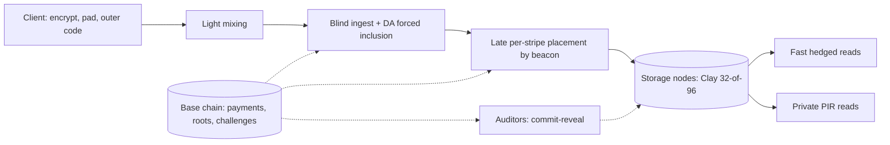

# Holoweave Design Doc

Oct 18, 2026 · @qingpinghe

## Overview and goals

Holoweave is a decentralized store built against **shadowbanning and narrative control**: the quiet, selective suppression of one person's project, post or archive so that it simply stops being found and nobody notices. Files are paid for once and kept for a fixed term (default 10 years). Holoweave does not stop a censor willing to take down everything; it makes sure the only censorship left is the loud kind.

**The problem.** Most real censorship is not a ban. A personal project drops out of search results, a host quietly stops serving one file, a link starts timing out for some readers. Each act is small, deniable and invisible to everyone except the author. It works because the censor can target one file precisely while nothing else is affected.

**The goal: no selective, quiet suppression.** Holoweave removes both things a shadowban needs:

- **Selective becomes impossible or broad.** Every stripe of a file sits on its own random set of holders, so making one file unreadable needs most of the entire network. Nodes can't tell which file they store or serve: on the private path the smallest thing a node can refuse is a whole PIR domain (at least 8 GB for hot data and 1 TB for cold data on CPU nodes, 64 GB or more on optional GPU servers).
- **Quiet becomes loud.** Every unanswered request is escalated automatically into a public on-chain challenge, so refusals leave signed, timestamped evidence tied to the file, and refusing on the private path takes down large, random slices of everyone else's data.

**Guarantees**

1. **Availability (mathematical):** a coalition below about 55% of the network's stake has a negligible chance (under 10^-18) of making any file unreadable; the threshold sits around two-thirds.
2. **Non-selectivity (mathematical):** within a PIR domain, a node's view is independent of which record is read, so any refusal hits the whole domain.
3. **Blind storage:** nodes can't identify a file at upload, inclusion or assignment, and no node holds an identifiable chunk of any file.
4. **Visible refusal:** every refusal produces a public challenge and a proof or penalty.
5. **Fast reads:** the default path is CDN-like; privacy costs latency only when used.
6. **Fixed-term economics and clean expiry:** prepaid escrow released only for audited service; whole groups expire together.

**Non-goals**

- **Stopping total bans.** A censor willing to block the whole network, or every bucket a node holds, can do so. Holoweave makes that loud and expensive, not impossible.
- **Proving that bytes were physically destroyed.** This is impossible without trusted hardware; Holoweave proves *expiry of obligation*, not deletion.
- **Hiding who is reading from a network observer.** That belongs to an anonymity layer (mixnet or Tor) underneath.
- **Permanent storage.** Terms are fixed; renewal is a new payment.

Formal definitions and proofs for G1 and G2 are in Security games, and a comparison with existing systems is in Comparison. Background math (the dropped sealing construction, coded PIR and doubly-efficient PIR) is in Research notes; the security review whose fixes are folded in is in Review log.

## Threat model and assumptions

The censor wants one specific file X to quietly become unavailable or hard to reach, for everyone or only for some readers, while everything else keeps working and it keeps its rewards. It may be any coalition of nodes, possibly a majority, and it knows X's address (addresses are public once shared), so it can read X like anyone else. Holoweave wins if every strategy open to the censor is either **broad** (it hurts many unrelated files) or **loud** (it is detected and punished). A censor that accepts both, by blocking everything, is out of scope.

| Adversary | Can do | Cannot do |
| --- | --- | --- |
| Any single node | Leave, refuse, corrupt its symbols | Matter to availability (readers never wait on it); refuse quietly |
| Coalition below about 55% of stake | Refuse or corrupt its own slots | Make any file unreadable (probability under 10^-18) |
| Coalition near two-thirds or more | Block a file on the fast path | Do it without public challenge evidence; refuse selectively on the private path |
| Batch builder | Withhold or reorder its own list | Stall the batch or exclude data forced through DA |
| Malicious uploader or reader | Submit garbage, send malformed queries | Frame builders or honest nodes |
| Network observer | See who talks to whom | Read content or queries; blocking the whole network is out of scope |

**Assumptions**

- Standard hardness: LWE (PIR) and collision-resistant hashing. No pairing assumptions or trusted setup.
- A base chain with honest-majority consensus, and a DA layer for forced inclusion, fraud proofs and challenges.
- An unbiasable threshold beacon (or VDF) for placement, audit assignment and mixing.
- Clients use an anonymity layer for uploads and private reads.
- Stake reflects real control (collateral makes it costly), and holders outside the coalition actually store and serve their symbols (audits).

## Architecture overview

A file moves through five stages, each unable to tell which file it is handling. The base chain anchors payments, commitments and disputes at every stage.

Uploads become outer-coded, lightly mixed ciphertext, forced through DA if needed, and spread so every stripe has its own random holders. Readers use fast hedged reads or the tiered private path; commit-reveal audits, costly challenges, immediate repair and yearly reshuffles keep the network honest until the group expires.

## Data encoding and placement

A file is spread so thinly and randomly that making it unreadable needs about 60% or more of the entire network. Four layers do this: an outer code over the file, light mixing between files, an inner regenerating code per stripe, and fresh random holders for every stripe.

**1. Client side**

- Encrypt with a fresh random key *K* (XChaCha20-Poly1305) and pad, so every stored byte is uniform random.
- Apply an **outer code** at rate 1/2: the ciphertext becomes *m* pieces of *p* = 32 KB, any *m*/2 of which rebuild the file. Minimum *m* = 32, so the smallest stored unit is 1 MB. Applications bundle small items (posts, comments) into bundles of at least 512 KB and address items as (bundle, offset).

**2. Light mixing (OFF-style)**

- Each piece is stored as a block *B* = piece ⊕ *R*₁ ⊕ *R*₂, where *R*₁ and *R*₂ are blocks already stored in the same expiry group, chosen by the beacon. Early in a group they are fresh random blocks.
- Every stored block takes part in several files, so no node holds an identifiable chunk of any file. Reading a piece means fetching 3 stored blocks and XORing them.

**3. Expiry groups and batches**

- A **group** is every upload in one calendar month with the same term; it expires as a whole (default 120 months later). Uploads enter one **batch** per epoch (1 day).
- Mixing draws randomizers only from the same group, so expiry never breaks a file in another group.

**4. Inner code and per-stripe placement**

- Stored blocks are grouped into **stripes** of *w* = 32 and encoded with a systematic **Clay code** (a minimum-storage regenerating code) to *n* = 96 symbols: 3x storage, any 32 rebuild the stripe, and a single lost symbol can be rebuilt by downloading about 1.5x its size.
- **Every stripe gets its own 96 holders**, drawn by the threshold beacon from the whole network in proportion to stake, with replacement (a node may hold several slots of one stripe), after the batch is final. Drawing with replacement keeps every operator's share of slots equal to its share of stake; drawing distinct nodes would let a censor running many small identities out-draw large honest operators. A file's stripes therefore sit on independent random holder sets, not on one fixed group of nodes. (Encoding every file across a fixed set of shards, as Walrus does, was considered and rejected: its exact two-thirds threshold is attractive, but the shard count caps how many operators the network can have.)
- Total storage overhead: 2x (outer) × 3x (inner) = 6x.

**5. Commitments (hash-only)**

- Each batch publishes a Merkle root over all its symbols. Readers check a symbol with a hash path, which is cheap and safe against quantum computers, and needs no trusted setup.
- If a builder publishes a stripe whose symbols are not a valid codeword, anyone holding 32 of its symbols posts a **bad-encoding fraud proof** (decode, re-encode, show the mismatching leaf), as in Celestia. The batch is rejected and the builder slashed.

**6. Sealing: dropped for v1**

- Sealing would stop one operator holding more than 32 slots of a stripe from storing only 32 symbols and computing the rest on demand. With per-stripe random placement, an operator needs about a third of all stake before it holds more than 32 slots in a meaningful share of stripes, and an operator that large is already a censorship concern. At 20% of stake it averages about 19 slots per stripe, so the storage it could save is negligible.
- Dropping sealing removes the hardware-advantage risk, the onboarding and repair cost of slow encoding, and an open review finding. The construction stays in the Research notes as a fallback if simulations show the slot-compression attack pays.

## Ingest and inclusion

Nobody along the upload path can tell which file is which, and the forced-inclusion path carries the data itself, so a missing upload can always be proven against the right party.

1. **Pay blindly.** The uploader buys storage credits in advance as blinded tokens. On-chain fees go through a shielded pool or a relayer, and refunds go to a blinded token, so no account links to the upload.
2. **Submit anonymously.** Over the anonymity layer, send the mixed, padded blocks to any ingest node and redeem credits.
3. **Build the batch.** Several builders each propose a list for the epoch. Each list is checked by data availability sampling on its own; the batch is the union of the lists that pass. A builder that lists withheld data only loses its own list.
4. **Force inclusion with data.** If a submission is still missing after *T* = 3 epochs, the uploader posts the blocks themselves to a data-availability (DA) blob. Only blob-posted data can be forced; builders who could see it on DA and still left it out are slashed. An uploader can no longer frame builders by posting a hash and withholding the data.
5. **Receipt.** The uploader receives Merkle paths proving inclusion. The address is (group, batch, block positions, mixing tuples, *K*). Publish it only after this step.
6. **Late assignment.** Only after finality does the beacon (a threshold beacon or VDF, so no single party can bias it) assign each stripe's 96 holders. Holders fetch their symbols from DA within a grace period, so a builder can't get an honest holder slashed by withholding its symbol.
7. **Exposure window.** Until assignment completes, ingest nodes and the uploader keep plain copies of the blocks, then drop them.

If a submission is dropped, the client re-encrypts under a new key and resubmits; the new upload can't be linked to the old one.

## Retrieval

Reads are fast by default and private when needed. The availability guarantee comes from placement, not from privacy, so the everyday path can be plain and CDN-fast; the private path adds non-selectivity and reader privacy.

**Fast path (default, tens of milliseconds)**

1. Try a gateway or cache first. Every block is checked against its batch's Merkle root, so caches can't alter content.
2. If the gateway is slow or fails, the client switches automatically to **direct hedged reads**: for about 60% of the file's *m* pieces, it requests the 3 stored blocks of each piece from their holders in parallel and keeps the first *m*/2 pieces that complete.
3. A holder that doesn't answer is simply skipped (the outer code absorbs it); if needed, the block is rebuilt from any 32 symbols of its stripe. The unanswered request is logged for challenge (see Audits, refusal and accountability).
4. Cost: about 4x the file size in downloads. A coalition below the availability threshold can't block or noticeably slow a read, because the client never waits on any particular holder.

**Private path (non-selective, reader-private)**

- A node answers PIR queries over a whole **PIR domain** and learns nothing about which record was asked for, so any refusal it makes hits the whole domain.
- PIR work per query grows with the domain size *D*, so a node's private-read capacity is roughly its compute throughput divided by *D* (estimates: about 200 GB/s of scanning for a 32-core CPU, about 100x that for a datacenter GPU). Each node publishes its domain sizes, subject to a protocol minimum. Two roles share the work:

| Role | Hardware | Hot domain | Cold domain | Private-read capacity (estimate) |
| --- | --- | --- | --- | --- |
| Storage node (default) | CPU and disks | At least 8 GB, in RAM | At least 1 TB, from disk | About 25 hot queries/s at 8 GB; about 700 cold queries/hour at 1 TB |
| Private-read server (optional) | GPU | 64 GB or more, in GPU memory | Mirrors only hot data | About 300 queries/s at 64 GB, about 100 ms latency |

- **Private-read servers mirror hot data.** Stored blocks are public ciphertext, verifiable against the Merkle roots, so GPU operators can mirror recent and popular data and serve it from large domains, earning private-read fees. Readers who want the largest blast radius use them; everyone else reads from storage nodes directly.
- Audits need only about 5,000 queries a day per node (under 0.1 per second), well within a CPU node's capacity at the minimum domain sizes.

* Scheme: YPIR, which needs no client hint, or a PIR with server preprocessing for static data (ReinsPIRe-style), chosen by benchmark. SimplePIR is ruled out: its measured client hint is about 100 MB per node and domain. The reader checks each answer against its Merkle path.
* **Fixed-shape reads.** Every private read sends the same number of queries, padded with dummies, spread over several batch passes and separate anonymity circuits, plus cover queries to random nodes. Nodes can't recognize a file read from timing or from which nodes are contacted.

**Discovery.** Holoweave can't stop a search engine from dropping a link, but anyone holding an address can fetch and verify the content. An optional append-only index of announced addresses, stored in Holoweave itself, gives one discovery channel that can't be quietly edited.

## Audits, refusal and accountability

These mechanisms don't create the anti-censorship guarantees; those come from placement and PIR. They keep the guarantees' assumptions true: that the rest of the network really stores and serves its data, and that every refusal leaves public evidence.

**Commit-reveal audits**

1. Each epoch the beacon assigns auditors, chosen from outside the audited stripes' holders, a set of (node, domain) targets.
2. The auditor commits `H(secret)` on-chain and sends an ordinary PIR query, indistinguishable from a real read.
3. After the epoch it reveals the secret and the node's signed (`H(query)`, answer). Anyone can verify that the audit happened and whether it passed.
4. Auditors are paid per verified reveal from the audit fund. A node's escrow for an epoch is released only if its revealed audits passed, which replaces the old KZG payout proof.

**Costly challenges for refusals**

- Any unanswered request, on either read path, is escalated automatically by the client. The audit fund pays for escalations, rate-limited per client token, so readers never post bonds by hand.
- The challenge goes to a DA blob; the node must post its answer within 2 epochs.
- Answering on-chain still costs the node a fixed penalty plus that epoch's escrow for the domain. Not answering means slashing, and its slots are rebuilt on fresh random holders. Quiet refusal is never free.

**Fraud proofs for wrong answers**

- Every answer is signed together with `H(query)`. A wrong private answer is proven by revealing the query secret and error term; the chain checks the query was well-formed, so malformed queries can't frame an honest node. PIR parameters are chosen to be correct for every well-formed query.
- A wrong block on the fast path is self-evident: its hash path doesn't match the Merkle root.
- Bounties are capped well below the slash and the difference is burned, so a node gains nothing by reporting itself through a Sybil.

**Public refusal log.** Every challenge is on-chain and names a record, and records map to files through addresses. A public dashboard of refusal rates per address turns a shadowban into signed, timestamped evidence.

**Capacity.** Nodes publish their service capacity, and queries are priced at their marginal scan cost. Refusals beyond published capacity aren't slashable, so flooding a node can't be used to frame it or to hide censorship as overload.

## Repair and reshuffling

Every stripe is kept at all 96 symbols, and holders change over time, so a censor can neither pick off holders one by one nor keep leverage over the ones it has.

- **Immediate repair.** When a symbol is lost (a node leaves, is slashed, or fails audits), the beacon picks a fresh random holder. Using the Clay code, it downloads about 1/64 of a symbol from each of the 95 other holders, about 1.5x the symbol's size, then stores it. There is no degraded window in which fewer colluders would suffice.
- **Yearly reshuffle.** Each year a random third of every stripe's slots hand off to new random holders, by direct transfer of the symbol. Any leverage a censor gains over specific holders expires.
- **Exit.** A leaving node hands each symbol directly to its replacement at about 1x bandwidth during an unbonding period. Leaving without handoff is slashed and triggers normal repair.
- **Mirrors.** Anyone may mirror ciphertext blocks and serve them on the fast path; readers verify them against the Merkle roots. Mirrors earn a share of read fees. Once a file is mirrored, removing it from the network's holders no longer removes it.

## Economics

The uploader pays the whole term up front, in a stablecoin, at a price fixed at purchase. Payment sits in escrow and is released per epoch only to holders whose revealed audits passed. There is no assumption that storage keeps getting cheaper.

| Share of an upload's fee | Recipient | Released |
| --- | --- | --- |
| Storage escrow (most of it) | Holders of the file's stripes, pro rata to symbols held | Each epoch, per node, only if its revealed audits passed |
| Ingest fee | Batch builders and ingest nodes | When the batch finalizes |
| Audit and repair fund | Auditors, client escalations, repairers, fraud-proof reporters | As work is verified |

**Collateral and slashing**

- Nodes post collateral proportional to symbols held. Collateral also makes stake, and therefore placement weight, expensive to accumulate.
- Slashable: failed revealed audits, unanswered challenges, fraud proofs, bad-encoding fraud proofs (builders), declining an assigned slot, leaving without handoff.
- Answering a challenge on-chain costs a fixed penalty plus that epoch's escrow for the domain.
- Bounties are capped below the slash; the rest goes to the audit and repair fund, as does escrow withheld from failing nodes.

**Reads** are paid per block or per PIR query with blinded tokens, priced at least at the marginal cost of serving them. Mirrors and gateways earn a share.

**Pricing.** New uploads are priced by governance or a capacity market; existing uploads never reprice. The fee split is set by simulation.

## Expiry

Expiry touches no data. Mixing draws randomizers only from the same group, so a whole group expires at once without affecting any other.

1. At the first epoch after `group.expiry`, the chain removes the group's root from the set of active roots.
2. Audits, escrow releases and challenges for the group stop, and collateral tied to it unbonds.
3. Nodes delete the group's symbols. The protocol stops paying for and checking them; nothing proves the bytes are gone, which would need trusted hardware.

**Renewal** means re-uploading as a new file with a new address. Whether to offer renewal that keeps the address (via a redirect record) is an open decision.

## Performance budget and parameters

At the defaults, storage overhead is 6x, fast reads cost about 4x the file size at CDN-like latency, and private reads take about 100 ms on GPU servers, under a second on CPU hot domains, and minutes for cold data. Figures assume a node with 20 TB (about 6.1 × 10^8 symbols of 32 KB); latency and GPU figures are estimates to confirm by benchmark.

**Parameters**

| Parameter | Default | Raising it | Lowering it |
| --- | --- | --- | --- |
| Stripe width *w* / holders per stripe *n* | 32 / 96 | Higher capture threshold; more storage | Less storage; lower threshold |
| Outer code rate / minimum pieces *m* | 1/2 / 32 | Rate lower or *m* higher: stronger per-file guarantee, more storage | Weaker guarantee for small files |
| Piece size *p* | 32 KB | Fewer symbols and leaves; more padding | Finer bundling; more metadata |
| Mixing degree | 2 randomizers (3 blocks per piece) | More deniability; costlier reads | Cheaper reads; less deniability |
| Hot PIR domain | At least 8 GB on CPU nodes; 64 GB or more on GPU servers | Bigger blast radius; more GPU memory | Cheaper hardware |
| Cold PIR domain | At least 1 TB on CPU nodes, from disk | Bigger blast radius; slower private reads | Faster cold reads; smaller blast radius |
| Audits per node per day | About 5,000 | Catches smaller losses; more auditor bandwidth | Cheaper |
| Yearly reshuffle | 1/3 of slots | Shorter leverage window; more bandwidth | Less churn |
| Epoch / group length / *T* | 1 day / 1 month / 3 epochs | Cheaper on-chain activity | Faster inclusion and finer expiry |

**Budget per node**

| Item | Cost at defaults | Verdict |
| --- | --- | --- |
| Fast reads | About 4x file size downloaded; tens of ms | OK |
| Hot private reads | 64 GB pass from GPU memory in about 20 ms; about 0.1 ms of GPU time per query; batches about every 100 ms | OK on optional GPU servers; CPU nodes serve 8 GB domains at about 25 queries/s |
| Cold private reads and audits | A 1 TB domain pass from disk at about 5 GB/s takes about 3 minutes; a 32-core CPU answers about 700 cold queries an hour | OK, needs fast disks |
| Audits | About 5,000 queries a day, carried by the regular passes; catches 0.05% missing data with about 92% probability per day | OK |
| Repair | About 1.5x a symbol per lost symbol; a departing 20 TB node costs about 30 TB of transfers spread over the network | OK |
| Commitments | Merkle hashing at ingest | Negligible |
| Storage | 6x overhead (2x outer, 3x inner) | Acceptable versus replication-based networks |

**Measured: SimplePIR on one CPU core (Oct 18, 2026).** A 2-core cloud VM (Intel Xeon, 2.1 GHz, AVX-512) ran the reference SimplePIR implementation; the server answer is single-threaded.

| Domain | Record size | Scan rate per core | Server time per query | Upload | Download | One-time client hint |
| --- | --- | --- | --- | --- | --- | --- |
| 128 MB | 1 bit | 9.5 GB/s | about 14 ms | 42 KB | 42 KB | 43 MB |
| 512 MB | 1 bit | 10.1 GB/s | about 50 ms | 85 KB | 85 KB | 87 MB |
| 512 MB | 32 KB | 9.7 GB/s | about 53 ms | 64 KB | 105 KB | 108 MB |

- **The throughput estimate holds.** About 10 GB/s per core means a 32-core node computes about 300 GB/s, likely capped by memory bandwidth at roughly 200 to 300 GB/s, matching the 200 GB/s assumed above. The 1 GB run exceeded the VM's 7 GB of RAM; per-core rate was flat from 128 MB to 512 MB.
- **Per-query traffic is fine:** about 170 KB to fetch one 32 KB record.
- **SimplePIR's client hint rules it out.** Each node and domain needs a one-time hint of about 100 MB, which for 32 KB records barely depends on domain size. Hints never change (data is immutable) and are public, so gateways could cache them, but a read touching dozens of holders would still need gigabytes. The private path should use YPIR, which needs no hint, or a scheme with a small hint. YPIR could not be built in this environment (its package registry was unreachable) and needs benchmarking on a development machine.

## Security guarantees and verification plan

The two core guarantees are mathematical, not economic: they hold whatever the censor does. Audits and slashing only keep their assumptions true.

**G1. Availability (from placement).** A coalition holding a share α of stake can make a given file unreadable only by capturing at least 65 of 96 holders in enough stripes to kill half the file's pieces (a piece dies if any of its 3 stripes is captured). For the minimum file of *m* = 32 pieces:

| Coalition share of all stake | Chance one file can be made unreadable |
| --- | --- |
| 33% | about 10^-177 |
| 50% | about 7 × 10^-43 |
| 55% | about 4 × 10^-20 |
| 60% | about 5 × 10^-5 (4 × 10^-8 for *m* = 64) |
| 65% | about 99% |

Below about 55% of the whole network, no file can be removed; around two-thirds, a coalition could black out most of the network anyway. Assumptions: holders outside the coalition actually store and serve (audits), stake reflects control (collateral), and the beacon is unbiased.

**G2. Non-selectivity (from PIR).** Within a PIR domain, a node's view of a query is computationally independent of which record it targets (LWE). So any refusal policy hits every record in the domain equally: refusing one file means refusing the whole domain the node has declared (at least 8 GB hot and 1 TB cold on CPU nodes, 64 GB or more on GPU servers). The blast radius of a refusal can never exceed the PIR work done per read, so domain size, not mixing, is the lever. Assumption: fixed-shape reads close timing and contact-pattern side channels.

**G3. Accountability.** Every wrong answer yields a valid fraud proof, every non-answer can be forced into an on-chain challenge, and malformed queries can't frame an honest node.

**G4. Blind ingest and inclusion.** No one can tell which submission is a given file, and any paid upload is included within *T* epochs or provably forced through DA.

**Above the threshold.** A coalition of about two-thirds or more can block a file on the fast path, but every blocked read produces public challenge evidence; on the private path it must refuse whole domains.

**Verification plan**

1. Write precise security games for G1 to G4 and prove them on paper. G1 is a probability bound plus a model of repair and reshuffling; G2 is a reduction to PIR query privacy plus a side-channel model.
2. Get an independent cryptographer to review the games and proofs.
3. Benchmark: GPU PIR on hot domains, whole-node cold passes, Clay repair bandwidth and disk reads, bad-encoding fraud proofs, square-root timing on CPU and GPU.
4. Simulate churn, repair, collusion and economics under realistic stake distributions.
5. Formalize selectively: Lean for the coding lemmas and the G1 bound, EasyCrypt for G2, Tamarin or ProVerif for the ingest and challenge protocols.

## Open decisions, risks and prior art

**Open decisions**

- [ ] Mixing degree: light (2 randomizers, the default) or heavier, trading read cost for deniability.
- [ ] Sealing: dropped for v1. Revisit only if simulations show operators gain by storing fewer symbols than the slots they hold.
- [ ] Outer code rate, minimum pieces per file, and the bundling rule for small items.
- [ ] Minimum PIR domain sizes (defaults: 8 GB hot, 1 TB cold) and fees for optional GPU private-read servers.
- [ ] Whether to add the optional committee that hides record positions from readers (true "nobody can find the bytes", at the cost of a threshold trust assumption).
- [ ] Whether to ship the in-network discovery index.
- [ ] Renewal that keeps an address, or not.
- [ ] Build or integrate: decided to build Holoweave's own network rather than layer on Walrus (see the Build or integrate tab).
- [ ] Fee split between escrow, ingest and the audit and repair fund.
- [ ] Legal and abuse policy for content that can't be removed during its term.

**Risks**

- The largest private-read blast radius depends on optional GPU servers; if few operators run them, that tier concentrates in few hands.
- PIR throughput in production may fall short of benchmark estimates.
- DA and base-chain throughput and cost for forced inclusion and challenges.
- Discovery (search engines, link sharing) stays outside Holoweave's control.

**Prior art.** Each layer exists somewhere; the combination aimed at silent, selective censorship does not, as far as searches turned up.

| System | Overlap with Holoweave |
| --- | --- |
| [Walrus](https://docs.wal.app/glossary.html) | Prepaid fixed-term storage in epochs, erasure coding, self-healing, holders changing per epoch |
| Storj | Erasure-coded segments placed on independent random nodes |
| OFF System (2006) | Blocks shared across files so no block belongs to one file |
| Tahoe-LAFS, Freenet | Client-side encryption, capability addresses, operators blind to content |
| [PIR-DSN (arXiv, 2025)](https://arxiv.org/abs/2512.07189v1) | PIR on a decentralized storage network, for reader privacy |
| [ReinsPIRe (ePrint 2026/1934)](https://eprint.iacr.org/2026/1934) | PIR with server preprocessing and a verifiable variant |
| Celestia, Ethereum danksharding | Data availability sampling, bad-encoding fraud proofs |
| Clay codes | Minimum-storage regenerating codes for cheap repair |
| Filecoin, Codex | Proofs of storage, sealing, fixed-term deals |
| [Recast (2020)](https://libra.unine.ch/bitstreams/2bb81a6f-f37b-4954-8603-b0fb3be971b8/download), [Aspnes et al.](https://www.cs.yale.edu/publications/techreports/tr1277.pdf) | Data entanglement for censorship resistance, and its theoretical limits |
| Arweave | The endowment model Holoweave replaces with fixed terms |
