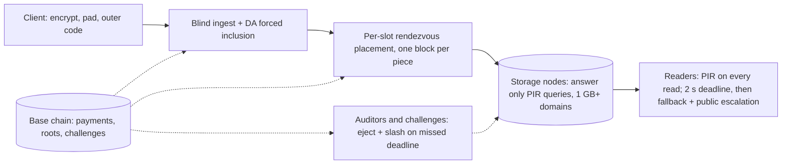

# Holoweave Design Doc

Oct 18, 2026 · @qingpinghe

## Overview and goals

Holoweave is a decentralized store built against **shadowbanning and narrative control**: the quiet, selective suppression of one person's project, post or archive so that it simply stops being found and nobody notices. Files are paid for once and kept for a fixed term (default 10 years). Holoweave does not stop a censor willing to take down everything; it makes sure the only censorship left is the loud kind.

**The problem.** Most real censorship is not a ban. A personal project drops out of search results, a host quietly stops serving one file, a link starts timing out for some readers. Each act is small, deniable and invisible to everyone except the author. It works because the censor can target one file precisely while nothing else is affected.

**The goal: no selective, quiet suppression.** Holoweave removes both things a shadowban needs:

- **Selective becomes impossible or broad.** Every stripe of a file sits on its own random set of holders, so making one file unreadable needs most of the entire network. Nodes can't tell which file they store or serve: every read is a PIR query, so the smallest thing a node can refuse is a whole PIR domain (at least 1 GB on CPU nodes, 64 GB or more on optional GPU servers).
- **Quiet becomes loud.** Every unanswered request is escalated automatically into a public on-chain challenge, so refusals leave signed, timestamped evidence tied to the file, and every refusal takes down large, random slices of everyone else's data.

**Guarantees**

1. **Availability (mathematical):** a coalition below about 57% of the network's stake has a negligible chance (under 10^-18) of making any file unreadable; the threshold sits around two-thirds.
2. **Non-selectivity (mathematical):** within a PIR domain, a node's view is independent of which record is read, so any refusal hits the whole domain.
3. **Blind storage:** nodes can't identify a file at upload, inclusion or assignment, and every stored byte is ciphertext. Without the file's address a node can't tell which file a block belongs to; with it, it still can't tell which of its blocks are being read.
4. **Visible refusal:** every refusal produces a public challenge and a proof or penalty.
5. **Private reads everywhere:** every read, on every device, is a PIR query, so no node ever sees which record is wanted. A post loads in about a second on CPU nodes and faster from GPU private-read servers.
6. **Fixed-term economics and clean expiry:** prepaid escrow released only for audited service; whole groups expire together.

**Non-goals**

- **Stopping total bans.** A censor willing to block the whole network, or every bucket a node holds, can do so. Holoweave makes that loud and expensive, not impossible.
- **Proving that bytes were physically destroyed.** This is impossible without trusted hardware; Holoweave proves *expiry of obligation*, not deletion.
- **Hiding who is reading from a network observer.** Out of scope. Nodes see who queries them; readers who need to hide their address can use Tor, which hides the address but not the pattern of a read.
- **Permanent storage.** Terms are fixed; renewal is a new payment.

Formal definitions and proofs for G1 and G2 are in Security games, and a comparison with existing systems is in Comparison. Background math (the dropped sealing construction, coded PIR and doubly-efficient PIR) is in Research notes; the security review whose fixes are folded in is in Review log.

## Threat model and assumptions

The censor wants one specific file X to quietly become unavailable or hard to reach, for everyone or only for some readers, while everything else keeps working and it keeps its rewards. It may be any coalition of nodes, possibly a majority, and it knows X's address (addresses are public once shared), so it can read X like anyone else. Holoweave wins if every strategy open to the censor is either **broad** (it hurts many unrelated files) or **loud** (it is detected and punished). A censor that accepts both, by blocking everything, is out of scope.

| Adversary | Can do | Cannot do |
| --- | --- | --- |
| Any single node | Leave, refuse, corrupt its symbols | Matter to availability (readers never wait on it); refuse quietly |
| Coalition below about 57% of stake | Refuse or corrupt its own slots | Make any file unreadable (probability under 10^-18) |
| Coalition near two-thirds or more | Block a file, but only by refusing whole domains on at least 65 holders of enough stripes | Refuse one file without refusing whole domains, or without leaving public challenge evidence |
| Batch builder | Withhold or reorder its own list | Stall the batch or exclude data forced through DA |
| Malicious uploader or reader | Submit garbage, send malformed queries | Frame builders or honest nodes |
| Network observer | See who talks to whom | Read content or queries; blocking the whole network is out of scope |

**Assumptions**

- Standard hardness: LWE (PIR) and collision-resistant hashing. No pairing assumptions or trusted setup.
- A base chain with honest-majority consensus, and a DA layer for forced inclusion, fraud proofs and challenges.
- An unbiasable threshold beacon (or VDF) for placement and audit assignment.
- Clients may use Tor for uploads and reads; nothing in Holoweave requires it.
- Stake reflects real control (collateral makes it costly), and holders outside the coalition actually store and serve their symbols (audits).

## Architecture overview

A file moves through five stages, each unable to tell which file it is handling. The base chain anchors payments, commitments and disputes at every stage.

Uploads become outer-coded ciphertext, forced through DA if needed, and spread so every stripe has its own random holders. Readers fetch every block by PIR, from any device; commit-reveal audits, costly challenges, immediate repair and yearly reshuffles keep the network honest until the group expires.

## Data encoding and placement

A file is spread so thinly and randomly that making it unreadable needs about 60% or more of the entire network. Three layers do this: an outer code over the file, an inner regenerating code per stripe, and fresh random holders for every stripe.

**1. Client side**

- Encrypt with a fresh random key *K* (XChaCha20-Poly1305) and pad, so every stored byte is uniform random.
- Apply an **outer code** at rate 1/2: the ciphertext becomes *m* pieces of *p* = 32 KB, any *m*/2 of which rebuild the file. Minimum *m* = 32, so the smallest stored unit is 1 MB. Applications bundle small items (posts, comments) into bundles of at least 512 KB and address items as (bundle, offset).

**2. Mixing: dropped**

- Earlier versions stored each piece XORed with two randomizer blocks from other files (OFF-style), so no stored block belonged to one file. It was dropped once PIR became mandatory: every read now hides which block is wanted, so mixing no longer adds protection on reads, and it tripled read cost (3 PIR queries per piece).
- Each piece is now stored directly as one block. Dropping mixing also strengthens availability: a piece lives in one stripe instead of three, so for a 60% coalition the chance of killing a file falls from about 5 × 10^-5 to about 10^-11. What mixing gave up is bystander damage at the storage level (deleting one file's blocks no longer corrupts others); the review log found that didn't deter a censor anyway.

**3. Expiry groups and batches**

- A **group** is every upload in one calendar month with the same term; it expires as a whole (default 120 months later). Uploads enter one **batch** per epoch (1 day).
- Groups exist so that expiry, escrow and collateral are accounted per month.

**4. Inner code and per-stripe placement**

- Stored blocks are grouped into **stripes** of *w* = 32 and encoded with a systematic **Clay code** (a minimum-storage regenerating code) to *n* = 96 symbols: 3x storage, any 32 rebuild the stripe, and a single lost symbol can be rebuilt by downloading about 1.5x its size.
- **Every stripe gets its own 96 holders**, placed by stake-weighted rendezvous hashing: each slot gets a beacon seed after the batch is final, and its holder is whichever current node ranks first for that seed, weighted by stake (a node may hold several slots of one stripe). Node identities come from the beacon after key registration, so they can't be ground to win chosen stripes. Because the holder depends only on the current node set, every operator's share of slots equals its share of stake at all times. Two earlier rules failed in simulation: drawing distinct nodes lets many small identities out-draw large honest operators, and giving each freed slot a fresh random holder lets a censor that never leaves ratchet its slot share far above its stake (see Security games, G1 under churn). A file's stripes therefore sit on independent random holder sets, not on one fixed group of nodes. (Encoding every file across a fixed set of shards, as Walrus does, was considered and rejected: its exact two-thirds threshold is attractive, but the shard count caps how many operators the network can have.)
- Total storage overhead: 2x (outer) × 3x (inner) = 6x.

**5. Commitments (hash-only)**

- Each batch publishes a Merkle root over all its symbols. Readers check a symbol with a hash path, which is cheap and safe against quantum computers, and needs no trusted setup.
- If a builder publishes a stripe whose symbols are not a valid codeword, anyone holding 32 of its symbols posts a **bad-encoding fraud proof** (decode, re-encode, show the mismatching leaf), as in Celestia. The batch is rejected and the builder slashed.

**6. Sealing: dropped for v1**

- Sealing would stop one operator holding more than 32 slots of a stripe from storing only 32 symbols and computing the rest on demand. With per-stripe random placement, an operator needs about a third of all stake before it holds more than 32 slots in a meaningful share of stripes, and an operator that large is already a censorship concern. At 20% of stake it averages about 19 slots per stripe, so the storage it could save is negligible.
- Dropping sealing removes the hardware-advantage risk, the onboarding and repair cost of slow encoding, and an open review finding. The construction stays in the Research notes as a fallback if simulations show the slot-compression attack pays.

## Ingest and inclusion

Nobody along the upload path can tell which file is which, and the forced-inclusion path carries the data itself, so a missing upload can always be proven against the right party.

1. **Pay blindly.** The uploader buys storage credits in advance as blinded tokens. On-chain fees go through a shielded pool or a relayer, and refunds go to a blinded token, so no account links to the upload.
2. **Submit anonymously.** Optionally over Tor, send the encrypted, padded blocks to any ingest node and redeem credits.
3. **Build the batch.** Several builders each propose a list for the epoch. Each list is checked by data availability sampling on its own; the batch is the union of the lists that pass. A builder that lists withheld data only loses its own list.
4. **Force inclusion with data.** If a submission is still missing after *T* = 3 epochs, the uploader posts the blocks themselves to a data-availability (DA) blob. Only blob-posted data can be forced; builders who could see it on DA and still left it out are slashed. An uploader can no longer frame builders by posting a hash and withholding the data.
5. **Receipt.** The uploader receives Merkle paths proving inclusion. The address is (group, batch, block positions, *K*). Publish it only after this step.
6. **Late assignment.** Only after finality does the beacon (a threshold beacon or VDF, so no single party can bias it) assign each stripe's 96 holders. Holders fetch their symbols from DA within a grace period, so a builder can't get an honest holder slashed by withholding its symbol.
7. **Exposure window.** Until assignment completes, ingest nodes and the uploader keep plain copies of the blocks, then drop them.

If a submission is dropped, the client re-encrypts under a new key and resubmits; the new upload can't be linked to the old one.

## Retrieval

**Every read is a PIR read, on every device.** There is no plain fast path and no gateway. A storage node never learns which record a request is for, so the smallest thing it can refuse is a whole PIR domain, for every reader at once. Anyone may mirror ciphertext, but mirrors also answer only PIR queries.

**Reading a post or a file**

1. From the address, the client works out which stored blocks it needs. For a small item, that is the one systematic piece holding it*, stored as a single block*. For a whole file, it is about *m*/2 pieces plus spares.
2. For each block, the client sends a PIR query to the block's holder, against the domain that contains the block.
3. If a holder doesn't answer within τ (default 2 s past its published latency), the client queries other holders of the same stripe (any 32 of 96 rebuild a block) and escalates the non-answer to a public challenge.
4. The client checks each answer against the batch's Merkle root and decrypts with *K*.

**Domains and node roles.** PIR work per query grows with the domain size, so a node's read capacity is roughly its scan throughput divided by its domain size. Each node publishes its domain sizes, subject to a protocol minimum.

| Role | Hardware | Hot domain | Cold domain | Capacity (measured on CPU, estimated on GPU) |
| --- | --- | --- | --- | --- |
| Storage node (default) | CPU and disks | At least 1 GB, in RAM | Older data in further 1 GB domains, scanned from disk or loaded on demand | About 0.46 core-seconds per 32 KB record at 1 GB, so about 70 records/s on 32 cores |
| Private-read server (optional) | GPU | 64 GB or more, in GPU memory | Mirrors only hot data | Roughly 100x a CPU's scan rate |

Private-read servers mirror recent and popular ciphertext, verify it against the Merkle roots, and earn read fees. Because every read is PIR, they are where most social-feed traffic should land.

**What a read costs** (YPIR, measured on one CPU core): one 32 KB record from a 1 GB domain takes about 0.46 core-seconds of server time, about 0.37 MB of upload (plus 473 KB of keys, sent once per node per session) and about 120 KB of download. Viewing one post is one record. A 50-post feed is about 19 MB of upload, workable on Wi-Fi but heavy on cellular, so:

- **Compressed queries for phones.** Lattice PIR schemes that expand a compact query on the server (the Spiral family) cut uploads to tens of KB, at the price of lower server throughput. [InsPIRe (2025)](https://iacr.org/news/item/26277) claims up to 50% smaller queries and 25% higher throughput than YPIR with no client hint. The phone scheme is chosen by benchmark; nodes can serve two schemes over the same domains.
- **On-device caching and prefetch.** A device never re-queries a block it already holds, and prefetches likely reads in fixed-shape batches when idle or on Wi-Fi. Keys for a node are reused within a session.

**Capacity follows reads, not storage.** Nodes can't cache by content, so network compute is views × domain size ÷ scan rate, plus a fixed packing cost per record. At 5 billion post views a day on CPUs and 1 GB domains, that is about 26,000 cores (about 1,300 storage nodes' worth of 32-core CPUs, each also busy with storage). GPU private-read servers can carry much of it. Readers pay per query at marginal cost, about $1.30 per million post views on CPUs, so capacity grows with fees.

**Scheme.** YPIR (no client hint) for desktops, compressed-query PIR for phones, both checked against Merkle paths. SimplePIR is ruled out by its client hint of about 100 MB per node and domain.

**What a node sees, and the service deadline.** Holoweave has no anonymity layer of its own (decided Oct 19, 2026, to keep it simple). A node sees who sends each query (an address, or a Tor exit if the reader chooses Tor), when, and which domain it targets; PIR hides only which record. So a node can single out a reader, or recognize a reader fetching a file or profile from the pattern of domains it queries. What it cannot do is refuse quietly:

- **Service deadline τ** (default 2 s past published latency). A later answer counts as a refusal.
- **Every refusal is escalated** to a public challenge naming the record, and the client fetches the block from the stripe's other holders in the meantime.
- **The node pays or leaves:** it answers on-chain at a penalty, or it is ejected and slashed.

A node that singles out readers or files can therefore slow them by at most τ per block without leaving evidence; anything more is on the public refusal log (Security games, G2).

**Discovery.** Holoweave can't stop a search engine from dropping a link, but anyone holding an address can fetch and verify the content. An optional append-only index of announced addresses, stored in Holoweave itself, gives one discovery channel that can't be quietly edited.

## Audits, refusal and accountability

These mechanisms don't create the anti-censorship guarantees; those come from placement and PIR. They keep the guarantees' assumptions true: that the rest of the network really stores and serves its data, and that every refusal leaves public evidence.

**Commit-reveal audits**

1. Each epoch the beacon assigns auditors, chosen from outside the audited stripes' holders, a set of (node, domain) targets.
2. The auditor commits `H(secret)` on-chain and sends an ordinary PIR query, indistinguishable from a real read.
3. After the epoch it reveals the secret and the node's signed (`H(query)`, answer). Anyone can verify that the audit happened and whether it passed.
4. Auditors are paid per verified reveal from the audit fund. A node's escrow for an epoch is released only if its revealed audits passed, which replaces the old KZG payout proof.

**Costly challenges for refusals**

- Any unanswered PIR query is escalated automatically by the client. The audit fund pays for escalations, rate-limited per client token, so readers never post bonds by hand.
- The challenge goes to a DA blob; the node must post its answer within 2 epochs.
- Answering on-chain still costs the node a fixed penalty plus that epoch's escrow for the domain. Not answering means automatic ejection and slashing (below). Quiet refusal is never free.

**Ejection.** A node that misses a challenge deadline is removed from the network by a fixed on-chain rule, never by a vote.

1. **Eject.** At the deadline the node leaves the node set. Rendezvous placement moves every one of its slots to the next-ranked holders, which rebuild them. The censor's share of stake drops at once, which tightens G1 directly instead of only raising its costs.
2. **Slash.** The node's bond is burned (bounties stay capped below it), so the same capital can't simply come back under a new identity.
3. **Warm-up for new identities.** A new node gets its identity from the beacon, then waits a warm-up period (default 30 days) before it ranks for any slot. A censor that keeps refusing loses time holding slots as well as money.
4. **Soft path for outages.** A node that was only offline still leaves the node set, since its slots have already moved. If it posts every overdue answer within a grace window, it pays a fixed fine instead of losing its whole bond and may rejoin through warm-up.
5. **Audits.** Each failed audit withholds that epoch's escrow; repeated failures within a window trigger ejection.
6. **No votes.** Only missed deadlines on public challenges eject a node. Governance cannot eject anyone, so a majority can't vote honest nodes out to raise its own share. An honest node that answers its challenges on-chain is never ejected, however many false challenges it receives.

Mass ejections show up in the churn analysis as slots awaiting rebuild: if outages get 10% of honest stake ejected at once while a 50% coalition holds firm, one file stays below about 10^-25 while the slots rebuild.

**Fraud proofs for wrong answers**

- Every answer is signed together with `H(query)`. A wrong private answer is proven by revealing the query secret and error term; the chain checks the query was well-formed, so malformed queries can't frame an honest node. PIR parameters are chosen to be correct for every well-formed query.
- A wrong decoded block is self-evident: its hash path doesn't match the Merkle root.
- Bounties are capped well below the slash and the difference is burned, so a node gains nothing by reporting itself through a Sybil.

**Public refusal log.** Every challenge is on-chain and names a record, and records map to files through addresses. A public dashboard of refusal rates per address turns a shadowban into signed, timestamped evidence.

**Capacity.** Nodes publish their service capacity, and queries are priced at their marginal scan cost. Refusals beyond published capacity aren't slashable, so flooding a node can't be used to frame it or to hide censorship as overload.

## Repair and reshuffling

Every stripe is kept at all 96 symbols, and holders change over time, so a censor can neither pick off holders one by one nor keep leverage over the ones it has.

- **Immediate repair.** When a symbol is lost (a node leaves or is ejected), the slot passes to the next-ranked current node for its seed. Using the Clay code, it downloads about 1/64 of a symbol from each of the 95 other holders, about 1.5x the symbol's size, then stores it. There is no degraded window in which fewer colluders would suffice.
- **Yearly reshuffle.** Each year a random third of every stripe's slots get new seeds and hand off to their new first-ranked holders, by direct transfer of the symbol. Joining nodes likewise take over the slots they now rank first on, so new honest stake dilutes the censor's slots instead of only filling freed ones. Rebuilds target 7 days, most-degraded stripes first; simulation shows months of margin under normal churn. Any leverage a censor gains over specific holders expires.
- **Exit.** A leaving node hands each symbol directly to its replacement at about 1x bandwidth during an unbonding period. Leaving without handoff is slashed and triggers normal repair.
- **Mirrors.** Anyone may mirror ciphertext blocks and serve them by PIR; readers verify them against the Merkle roots. Mirrors earn a share of read fees. Once a file is mirrored, removing it from the network's holders no longer removes it.

## Economics

The uploader pays the whole term up front, in a stablecoin, at a price fixed at purchase. Payment sits in escrow and is released per epoch only to holders whose revealed audits passed. There is no assumption that storage keeps getting cheaper.

| Share of an upload's fee | Recipient | Released |
| --- | --- | --- |
| Storage escrow (most of it) | Holders of the file's stripes, pro rata to symbols held | Each epoch, per node, only if its revealed audits passed |
| Ingest fee | Batch builders and ingest nodes | When the batch finalizes |
| Audit and repair fund | Auditors, client escalations, repairers, fraud-proof reporters | As work is verified |

**Collateral and slashing**

- Nodes post collateral proportional to symbols held. Collateral also makes stake, and therefore placement weight, expensive to accumulate.
- Ejected and slashed: unanswered challenges and repeated failed audits (see Ejection). Slashed only: single failed revealed audits, fraud proofs, bad-encoding fraud proofs (builders), declining an assigned slot, leaving without handoff.
- Answering a challenge on-chain costs a fixed penalty plus that epoch's escrow for the domain.
- Bounties are capped below the slash; the rest goes to the audit and repair fund, as does escrow withheld from failing nodes.

**Reads** are paid per PIR query with blinded tokens, priced at least at the marginal cost of serving them. Mirrors earn a share. There are no gateways: every device queries nodes directly.

**Pricing.** New uploads are priced by governance or a capacity market; existing uploads never reprice. The fee split is set by simulation.

## Expiry

Expiry touches no data. Files never share blocks, so a whole group expires at once without affecting any other.

1. At the first epoch after `group.expiry`, the chain removes the group's root from the set of active roots.
2. Audits, escrow releases and challenges for the group stop, and collateral tied to it unbonds.
3. Nodes delete the group's symbols. The protocol stops paying for and checking them; nothing proves the bytes are gone, which would need trusted hardware.

**Renewal** means re-uploading as a new file with a new address. Whether to offer renewal that keeps the address (via a redirect record) is an open decision.

## Performance budget and parameters

At the defaults, storage overhead is 6x, every read is a PIR read and takes about 100 ms on GPU servers and about half a second of CPU per block on CPU nodes with 1 GB domains, run in parallel across holders. Figures assume a node with 20 TB (about 6.1 × 10^8 symbols of 32 KB); latency and GPU figures are estimates to confirm by benchmark.

**Parameters**

| Parameter | Default | Raising it | Lowering it |
| --- | --- | --- | --- |
| Stripe width *w* / holders per stripe *n* | 32 / 96 | Higher capture threshold; more storage | Less storage; lower threshold |
| Outer code rate / minimum pieces *m* | 1/2 / 32 | Rate lower or *m* higher: stronger per-file guarantee, more storage | Weaker guarantee for small files |
| Piece size *p* | 32 KB | Fewer symbols and leaves; more padding | Finer bundling; more metadata |
| Mixing | None (dropped Oct 19) | Each randomizer adds a PIR query per read and a stripe the piece can die from | Not applicable |
| Hot PIR domain | At least 1 GB on CPU nodes; 64 GB or more on GPU servers | Bigger blast radius; more GPU memory | Cheaper hardware |
| Cold PIR domain | Same 1 GB minimum; older data spread over more domains, read from disk | Bigger blast radius; slower private reads | Faster cold reads; smaller blast radius |
| Audits per node per day | About 5,000 | Catches smaller losses; more auditor bandwidth | Cheaper |
| Yearly reshuffle | 1/3 of slots | Shorter leverage window; more bandwidth | Less churn |
| Epoch / group length / *T* | 1 day / 1 month / 3 epochs | Cheaper on-chain activity | Faster inclusion and finer expiry |

**Budget per node**

| Item | Cost at defaults | Verdict |
| --- | --- | --- |
| Plain reads | Removed: every read is a PIR read (see Retrieval) | OK |
| Hot private reads | 64 GB pass from GPU memory in about 20 ms; about 0.1 ms of GPU time per query; batches about every 100 ms | OK on optional GPU servers; CPU nodes serve 1 GB domains at about 70 records/s on 32 cores |
| Cold private reads and audits | Older data sits in further 1 GB domains; a pass from disk at about 5 GB/s takes about 0.2 s per query | OK, needs fast disks |
| Audits | About 5,000 queries a day, carried by the regular passes; catches 0.05% missing data with about 92% probability per day | OK |
| Repair | About 1.5x a symbol per lost symbol; a departing 20 TB node costs about 30 TB of transfers spread over the network | OK |
| Commitments | Merkle hashing at ingest | Negligible |
| Storage | 6x overhead (2x outer, 3x inner) | Acceptable versus replication-based networks |

**Measured: SimplePIR on one CPU core (Oct 18, 2026).** A 2-core cloud VM (Intel Xeon, 2.1 GHz, AVX-512) ran the reference SimplePIR implementation; the server answer is single-threaded.

| Domain | Record size | Scan rate per core | Server time per query | Upload | Download | One-time client hint |
| --- | --- | --- | --- | --- | --- | --- |
| 128 MB | 1 bit | 9.5 GB/s | about 14 ms | 42 KB | 42 KB | 43 MB |
| 512 MB | 1 bit | 10.1 GB/s | about 50 ms | 85 KB | 85 KB | 87 MB |
| 512 MB | 32 KB | 9.7 GB/s | about 53 ms | 64 KB | 105 KB | 108 MB |

- **The throughput estimate holds.** About 10 GB/s per core means a 32-core node computes about 300 GB/s, likely capped by memory bandwidth at roughly 200 to 300 GB/s, matching the 200 GB/s assumed above. The 1 GB run exceeded the VM's 7 GB of RAM; per-core rate was flat from 128 MB to 512 MB.
- **Per-query traffic is fine:** about 170 KB to fetch one 32 KB record.
- **SimplePIR's client hint rules it out.** Each node and domain needs a one-time hint of about 100 MB, which for 32 KB records barely depends on domain size. Hints never change (data is immutable) and are public, but a read touching dozens of holders would still need gigabytes of hints on the device. Reads should use YPIR, which needs no hint, or a scheme with a small hint. **Measured: YPIR+SP (Oct 19, 2026).** On one core of a Ryzen 5 7600X with AVX-512: a 512 MB domain answers a 3.5 KB item in 116 ms (84 ms scan, 30 ms packing), with 2.3 MB upload (473 KB of it reusable keys), 12 KB download and **no client hint**. A 32 KB record is served as 10 parallel instances: about 370 ms on one core for a 512 MB domain, about 120 KB download, under 0.6 MB upload. Scan runs at 6.5–11 GB/s per core, matching the 200 GB/s node budget. Packing costs about 30 ms per instance whatever the domain size, which favors large domains. YPIR replaces SimplePIR; full numbers are in the project's sim/SIMULATION.md.

## Security guarantees and verification plan

The two core guarantees are mathematical, not economic: they hold whatever the censor does. Audits and slashing only keep their assumptions true.

**G1. Availability (from placement).** A coalition holding a share α of stake can make a given file unreadable only by capturing at least 65 of 96 holders in enough stripes to kill half the file's pieces (each piece is one block in one stripe). For the minimum file of *m* = 32 pieces:

| Coalition share of all stake | Chance one file can be made unreadable |
| --- | --- |
| 33% | about 10^-186 |
| 50% | about 5 × 10^-51 |
| 55% | about 5 × 10^-28 |
| 60% | about 10^-11 (about 10^-20 for *m* = 64) |
| 65% | about 1.5% (0.2% for m = 64) |

Below about 57% of the whole network, no file can be removed; around two-thirds, a coalition could black out most of the network anyway. Assumptions: holders outside the coalition actually store and serve (audits), stake reflects control (collateral), and the beacon is unbiased. Under churn the same bound holds with the coalition share replaced by β, the share of slots not served by an available honest holder (the coalition's slots plus honest slots that are offline or awaiting rebuild); keep β below about 57% (60% with 2 MB minimum files). Normal churn with a 7-day rebuild adds almost nothing. Large correlated outages and seizures are the real risk: a 50% coalition plus a 20% outage gives about 2 × 10^-10 per file and a 30% outage about 4%, and seized data cannot be rebuilt if the coalition withholds its share (see Security games, G1 under churn).

**G2. Record privacy and loudness (from PIR and challenges).** *G2a:* a node's view of a query is computationally independent of which record in the domain it targets (LWE), whatever else the node knows about the reader. So a refusal that doesn't use who is asking hits every record in the domain equally, at least 1 GB on CPU nodes and 64 GB or more on GPU servers. *G2b:* nodes do see who is asking and can recognize file or profile reads from their pattern, but every refusal or answer later than τ is escalated publicly, the reader fetches the block from other holders, and the node pays on-chain or is ejected. A node can quietly slow a read by at most τ per block; anything more is public. G2b needs no network assumption.

**G3. Accountability.** Every wrong answer yields a valid fraud proof, every non-answer can be forced into an on-chain challenge, and malformed queries can't frame an honest node.

**G4. Blind ingest and inclusion.** No one can tell which submission is a given file, and any paid upload is included within *T* epochs or provably forced through DA.

**Above the threshold.** A coalition of about two-thirds or more can block a file only by refusing whole domains on many holders, and every refused query produces public challenge evidence.

**Verification plan**

1. Write precise security games for G1 to G4 and prove them on paper. G1 is a probability bound plus a model of repair and reshuffling; G2 is a reduction to PIR query privacy plus a side-channel model.
2. Get an independent cryptographer to review the games and proofs.
3. Benchmark: GPU PIR on hot domains, whole-node cold passes, Clay repair bandwidth and disk reads, bad-encoding fraud proofs, square-root timing on CPU and GPU.
4. Simulate churn, repair, collusion and economics under realistic stake distributions.
5. Formalize selectively: Lean for the coding lemmas and the G1 bound, EasyCrypt for G2, Tamarin or ProVerif for the ingest and challenge protocols.

## Open decisions, risks and prior art

**Open decisions**

- [ ] Mixing: decided Oct 19 to drop it. With mandatory PIR it added no read protection, tripled read cost and gave each piece three stripes to die from.
- [ ] Sealing: dropped for v1. Revisit only if simulations show operators gain by storing fewer symbols than the slots they hold.
- [ ] Outer code rate, minimum pieces per file, and the bundling rule for small items. Churn analysis favors a 64-piece (2 MB) minimum: it raises the tolerated share β from about 57% to 60% at no storage cost, and raises the number of operators an adaptive censor must coerce.
- [ ] Minimum PIR domain size (decided Oct 19: 1 GB for all data) and fees for optional GPU private-read servers. PIR scheme for phones: compressed-query lattice PIR (tens of KB per query, slower servers) or YPIR/InsPIRe (about 1–3 MB per query); needs a benchmark.
- [ ] Whether to add the optional committee that hides record positions from readers (true "nobody can find the bytes", at the cost of a threshold trust assumption).
- [ ] Whether to ship the in-network discovery index.
- [ ] Renewal that keeps an address, or not.
- [ ] Build or integrate: decided to build Holoweave's own network rather than layer on Walrus (see the Build or integrate tab).
- [ ] Fee split between escrow, ingest and the audit and repair fund.
- [ ] Legal and abuse policy for content that can't be removed during its term.

**Risks**

- The largest private-read blast radius depends on optional GPU servers; if few operators run them, that tier concentrates in few hands.
- PIR throughput in production may fall short of benchmark estimates.
- DA and base-chain throughput and cost for forced inclusion and challenges.
- **Accepted vulnerability: operator independence (Sybil).** Holoweave cannot tell whether many identities belong to one organisation, and does not try. G1's guarantees count stake, not independent operators. If real stake is concentrated, coercing a few large operators may be enough: about 82 on a 1,000-node network where the top 10 hold 39% of stake. Per-identity caps or sublinear rewards do not help, because a large operator can split into many identities. This is left open by decision (Oct 19, 2026).
- Discovery (search engines, link sharing) stays outside Holoweave's control. Mandatory PIR makes compute grow with views, about 0.46 core-seconds per post view at 1 GB domains on CPU, and about 0.4 MB of upload per view on phones until a compressed-query scheme is in place. GPU private-read servers and a compressed-query scheme are the levers.

**Prior art.** Each layer exists somewhere; the combination aimed at silent, selective censorship does not, as far as searches turned up.

| System | Overlap with Holoweave |
| --- | --- |
| [Walrus](https://docs.wal.app/glossary.html) | Prepaid fixed-term storage in epochs, erasure coding, self-healing, holders changing per epoch |
| Storj | Erasure-coded segments placed on independent random nodes |
| OFF System (2006) | Blocks shared across files so no block belongs to one file |
| Tahoe-LAFS, Freenet | Client-side encryption, capability addresses, operators blind to content |
| [PIR-DSN (arXiv, 2025)](https://arxiv.org/abs/2512.07189v1) | PIR on a decentralized storage network, for reader privacy |
| [ReinsPIRe (ePrint 2026/1934)](https://eprint.iacr.org/2026/1934) | PIR with server preprocessing and a verifiable variant |
| Celestia, Ethereum danksharding | Data availability sampling, bad-encoding fraud proofs |
| Clay codes | Minimum-storage regenerating codes for cheap repair |
| Filecoin, Codex | Proofs of storage, sealing, fixed-term deals |
| [Recast (2020)](https://libra.unine.ch/bitstreams/2bb81a6f-f37b-4954-8603-b0fb3be971b8/download), [Aspnes et al.](https://www.cs.yale.edu/publications/techreports/tr1277.pdf) | Data entanglement for censorship resistance, and its theoretical limits |
| Arweave | The endowment model Holoweave replaces with fixed terms |
