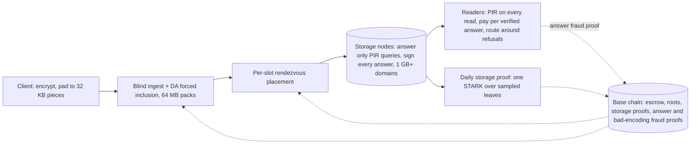

# Holoweave design

Current design as of Oct 19, 2026. How it got here (what was tried, dropped and why) is in [appendix/history.md](appendix/history.md).

## Overview

Holoweave is a decentralized store built against **shadowbanning and narrative control**: the quiet, selective suppression of one person's project, post or archive so that it stops being found and nobody notices. Files are paid for once and kept for a fixed term (default 10 years). Holoweave does not stop a censor willing to take down most of the network; it makes removing one chosen file cost about as much as that.

**The problem.** Most real censorship is not a ban. A project drops out of search results, a host quietly stops serving one file, a link starts timing out for some readers. Each act is small, deniable and visible only to the author. It works because the censor can target one file precisely while nothing else is affected.

**Audit trails without a trusted group.** The same property supports tamper-evident audit trails for supply chains and large organizations. Such trails usually depend on a small trusted group (admins, database owners, a vendor) who could alter or delete entries for personal gain. In Holoweave every record is committed on chain when stored, so altering it is detectable, and removing one chosen record takes about two-thirds of all stake. Records last for a fixed prepaid term; the list of record addresses still needs an append-only home, such as the optional discovery index (Retrieval).

**How Holoweave stops it.**

- **Removing one file takes about two-thirds of the network.** Files are erasure-coded together in 64 MB packs, and every piece of a pack sits in its own stripe on its own random holders. Making one chosen file unreadable means destroying more than half of its pack's 4,096 stripes, which takes about two-thirds of all stake: the same stake that could black out most of the network anyway.
- **Nodes can't single out a file.** Every read is a PIR query, so a node never learns which record a query is for. Every answer is signed. A node that deletes or corrupts a chosen file's record hands that file's readers wrong answers they can prove, and it loses its bond; because it can't tell which queries are theirs, it can't avoid them. Its only unpunished option is to refuse, which can't single out one record, and readers route around refusals to other holders.

**Guarantees** (stated precisely under Security guarantees below)

- **G1, availability.** A coalition below about 66% of stake has under 10^-18 chance of making a chosen file unreadable. The bound is per file; over many files a union bound applies.
- **G2, record privacy and routing around refusals.** A node's view of a query is independent of which record in the domain it targets, whatever else it knows about the reader. Below G1's threshold a refused piece is rebuilt from other holders (about 32 extra queries, in parallel), and the node earns nothing for it.
- **G3, no unpunished selective deletion.** A node that serves one record's readers worse than other readers of the same domain must give them wrong signed answers, and each one is provable. The penalty is the node's bond.
- **G4, blind ingest and inclusion.** Nodes can't identify a file at upload, inclusion or assignment, every stored byte is ciphertext, and any paid upload is included or provably forced through DA. Once a file's address is public, anyone, including its holders, can work out where its pieces are; from then on G1 to G3 protect it.

Alongside these: fixed-term economics (prepaid escrow released only for proven storage, reads paid per verified answer) and clean expiry of whole groups.

**Non-goals**

- **Stopping total bans.** A censor willing to block or destroy most of the network can do so. Holoweave makes targeting one file cost about that much.
- **Proving bytes were destroyed.** Impossible without trusted hardware; Holoweave proves *expiry of obligation*, not deletion.
- **Hiding who is reading.** Nodes see who queries them. Readers can use Tor, which hides their address but not the pattern of a read.
- **Phones as a design target.** Every device runs the same PIR client; phone-specific optimizations are out of scope for v1.
- **Operator independence.** Holoweave counts stake, not independent organizations (see Risks).
- **Permanent storage.** Terms are fixed; renewal is a new payment.

Formal definitions and proofs are in [security-games.md](security-games.md); a comparison with existing systems is in [comparison.md](comparison.md).

## Threat model and assumptions

The censor wants one file X to become unavailable or hard to reach, for everyone or only for some readers, while everything else keeps working and it keeps its rewards. It may be any coalition of nodes, possibly a majority. It knows X's address (addresses are public once shared), so it can read X like anyone else and work out which of its own symbols belong to X. Holoweave wins if every strategy open to the censor is either **broad** (it needs most of the network) or **futile** (readers route around it) or **punished** (it costs the nodes involved their bonds).

| Adversary | Can do | Cannot do |
| --- | --- | --- |
| Any single node | Leave; refuse; single out readers by address; delete or corrupt its own symbols | Make any file unavailable; get paid for refusing; delete or corrupt a chosen file's record and keep serving its domain without being slashed once the file is read |
| Coalition below about 66% of stake | All of the above; make a chosen file slower or costlier for some readers | Make a chosen file unreadable (probability under 10^-18) |
| Coalition near two-thirds or more | Destroy more than half of a pack's stripes, killing a chosen file | Do it without destroying thousands of stripes, at a stake where it could black out most of the network anyway; avoid being slashed for it |
| Batch builder | Withhold or reorder its own list | Stall the batch or exclude data forced through DA |
| Malicious uploader or reader | Submit garbage, send malformed queries | Frame builders or honest nodes |
| Network observer | See who talks to whom | Read content or queries; blocking the whole network is out of scope |

**Assumptions**

- Standard hardness: LWE (PIR) and collision-resistant hashing (data, commitments, storage proofs, fraud proofs). The only pairing-based component is the threshold beacon, or a VDF instead.
- A base chain with honest-majority consensus that does not share Holoweave's stake, and a DA layer for forced inclusion, storage proofs and fraud proofs.
- An unbiasable threshold beacon (or VDF) for placement, identity activation and storage-proof sampling.
- Stake reflects real control (collateral makes it costly), and holders outside the coalition actually store their symbols (storage proofs). Whether they also serve reads is an incentive (read fees), not a guarantee; nodes that don't serve count against the availability budget β.
- Clients may use Tor; nothing requires it.

## Architecture

A file moves through five stages, none of which can tell which file it is handling until the address is published. The base chain anchors payments, commitments, storage proofs and fraud proofs.

## Data encoding and placement

Three layers spread a file so that making it unreadable needs about two-thirds of all stake: an outer code over 64 MB packs, an inner regenerating code per stripe, and independent random holders for every stripe.

**1. Client**

- Encrypt with a fresh random key *K* (XChaCha20-Poly1305) and pad to whole pieces of 32 KB, so every stored byte is uniformly random. Applications pack small items (posts, comments) into pieces and address them as (piece, offset).
- Submit the encrypted pieces. Redundancy is added by the pack, not by the client.

**2. Packs: one outer code over many files**

- The batch builder groups the pieces of many uploads into **packs** of *K* = 2,048 data pieces (64 MB) and adds 2,048 parity pieces with a systematic Reed-Solomon code. Any 2,048 of a pack's 4,096 pieces rebuild the whole pack. Data pieces are stored as they are, so a normal read fetches only a file's own pieces.
- To make a chosen file unrecoverable, a coalition must destroy more than half of its pack's 4,096 stripes: at least 2,049 stripes, about 6 GB of stored symbols. That takes about two-thirds of all stake.
- Other files in a destroyed pack stay readable, because their own pieces are stored as-is. The pack forces scale and stake, not collateral loss.
- If a coalition does destroy the stripes holding a file's own pieces, a reader rebuilds them from the pack: about 2,048 PIR queries and 0.26 core-hours. The first reader to rebuild can republish the file.

**3. Batches and expiry groups**

- Uploads enter one **batch** per epoch (1 day). A **group** is every upload in one calendar month with the same term; it expires as a whole (default 120 months later). Packs and stripes are formed within one batch, so no stored piece or symbol spans groups.

**4. Stripes and placement**

- Stored pieces are grouped into **stripes** of *w* = 32 and encoded with a systematic **Clay code** (a minimum-storage regenerating code) to *n* = 96 symbols: 3x storage, any 32 rebuild the stripe. The code is built for *d* = 80 repair helpers: a lost symbol is rebuilt from any 80 of the other 95 holders at about 1.6x its size.
- **Every stripe gets its own 96 holders**, chosen by stake-weighted rendezvous hashing. Each slot gets a beacon seed after the batch is final; its holder is the current node that ranks first for that seed, weighted by stake. A node may hold several slots of one stripe. Because the holder depends only on the current node set, every operator's share of slots equals its share of stake at all times, whatever the history of joins and exits.
- **No stake grinding.** An identity's ranking key is *H*(seed, id, *r*), where *r* is a beacon value revealed only after the identity's stake is locked. Stake is fixed per identity; changing stake means a new identity with a new *r* and a new warm-up. This stops a coalition from trying many identities against a target's published seeds and moving stake into the best-ranked ones.
- A pack's pieces sit in 4,096 distinct stripes with independent holder sets.
- Total storage overhead: 2x (pack code) × 3x (stripe code) = 6x.

**5. Commitments**

- Each batch publishes a Merkle root over 1 KB leaves of all its symbols, using a STARK-friendly hash (such as Poseidon2) so storage proofs can open many leaves cheaply; a symbol is a subtree of 32 leaves. Readers check a symbol with a hash path: cheap, post-quantum and with no trusted setup.
- If a builder publishes a stripe or pack whose symbols are not a valid codeword, anyone holding enough symbols posts a **bad-encoding fraud proof** (decode, re-encode, show the mismatching leaf). The batch is rejected and the builder slashed. (The fraud proof for the pack code still has to be specified.)

**6. Accepted: storage deduplication by colluding operators**

An operator holding 32 or more slots of one stripe can store 32 symbols and compute the rest on demand. Colluding operators could save about 5% of storage at 33% of stake, 17% at 40% and 33% at 50%. This is accepted: it saves them storage but doesn't reduce availability, because the symbols can still be produced.

## Ingest and inclusion

Nobody on the upload path can tell which file is which, and the forced-inclusion path carries the data itself, so a missing upload can always be proven against the right party.

1. **Pay blindly.** The uploader buys storage credits in advance as blinded tokens. On-chain fees go through a shielded pool or relayer, and refunds go to a blinded token, so no account links to the upload.
2. **Submit.** Optionally over Tor, send the encrypted, padded pieces to any ingest node and redeem credits.
3. **Build the batch.** Several builders each propose a list for the epoch. Each list is checked by data availability sampling on its own; the batch is the union of the lists that pass, so a builder that lists withheld data only loses its own list. Builders then form packs and stripes.
4. **Force inclusion with data.** If a submission is still missing after *T* = 3 epochs, the uploader posts the pieces to a DA blob. Builders who could see it on DA and still left it out are slashed.
5. **Receipt.** The uploader receives Merkle paths proving inclusion. The address is (group, batch, pack, piece positions, *K*). Publish it only after this step.
6. **Late assignment.** Only after finality does the beacon assign each stripe's holders. Holders fetch their symbols from DA within a grace period, so a builder can't get an honest holder penalized by withholding its symbol.
7. **Exposure window.** Until assignment completes, ingest nodes and the uploader keep plain copies of the pieces, then drop them.

A dropped submission is re-encrypted under a new key and resubmitted; the two can't be linked.

## Retrieval

**Every read is a PIR read.** There is no plain fast path and no gateway. Anyone may mirror ciphertext, but mirrors also answer only PIR queries.

**Reading a post or a file**

1. From the address, the client works out which pieces it needs: the one piece holding a post, or a file's own data pieces.
2. For each piece, it sends a PIR query to the piece's holder, against the domain that contains it. Each PIR record is the 32 KB symbol plus its Merkle path (about 1 KB), so the client needs no other metadata from the node.
3. The client checks each signed answer against the batch's Merkle root and decrypts with *K*.
4. If a holder doesn't answer within a few seconds, or its answer fails the Merkle check, the client doesn't pay it and rebuilds that piece from 32 other holders of its stripe (about 32 queries, in parallel). It remembers refusing nodes and goes straight to the rebuild next time. Only if the stripe itself is dead does it rebuild from the pack. A wrong signed answer is also grounds for an answer fraud proof (below).

**Domains.** PIR work per query grows with domain size. **Domain layout is fixed by a public rule** (symbols go into 1 GB domains in order of batch and slot seed), and readers reject a node whose domains don't follow it, so a node can't put a target in a domain of filler and refuse that domain cheaply.

| Role | Hardware | Domain | Capacity |
| --- | --- | --- | --- |
| Storage node (default) | CPU, NVMe | At least 1 GB, hot in RAM; older data in further 1 GB domains read from NVMe | About 0.46 core-seconds per 32 KB record at 1 GB (extrapolated from measured runs), so about 70 records/s on 32 cores |
| Private-read server (optional) | GPU | 64 GB or more in GPU memory; mirrors only hot data | Estimated: about 20 ms per 64 GB pass, so about 50 passes/s per GPU |

A GPU server's advantage is a 64x larger domain at similar throughput, not raw speed. Private-read servers mirror recent and popular ciphertext, verify it against the Merkle roots and earn read fees.

**What a read costs** (YPIR, no client hint): one 32 KB record from a 1 GB domain takes about 0.46 core-seconds of server time, about 0.23 MB of query upload plus 473 KB of keys sent once per node per session, and about 120 KB of download. A post is one record. A device never re-queries a block it already holds.

**Capacity follows reads, not storage.** Nodes can't cache by content, so network compute is views × domain size ÷ scan rate, plus a fixed packing cost per record. At 5 billion post views a day on CPUs and 1 GB domains, that is about 26,000 cores (about $1.30 per million views at $0.01 per core-hour).

**What a node sees.** A node sees who sends each query (an address or a Tor exit), when, and which domain it targets; PIR hides which record. Once a file's address is public, a holder also knows which of its own symbols belong to that file. So a node can single out a reader, recognize a file or profile read from the pattern of domains queried, or delete or corrupt one chosen symbol. Below the threshold none of this makes a file unavailable, none of it is paid, and deleting or corrupting is slashed:

- **Refusals are routed around.** A refused piece is rebuilt from 32 other holders of its stripe: about 32 queries instead of 1, in parallel.
- **The cost lands on readers and honest nodes.** A coalition that refuses every single-piece read multiplies the load on honest holders by (1 − α) + 32α: about 4x at 10% of stake, 10x at 30%, 16x at 50%. Honest nodes are paid for the extra load, but readers pay more. A coalition can aim this at one reader, one country or one author's readers.
- **Fallback leaks interest.** The other holders a reader turns to for a rebuild see the reader's address and can infer which stripe, and roughly which file, the reader wanted.

**Signed answers and answer fraud proofs.** Every PIR answer is signed by the node together with the hash of the query it answers. The client derives each query from a fresh random seed. If a signed answer fails the Merkle check, the client can post an **answer fraud proof**: the signed query hash and answer, the seed, and the expected record with its Merkle path. Anyone can rebuild the query from the seed, check it hashes to what the node signed, decrypt the answer and see that it differs from the committed record. The proof is checked on chain through a small STARK posted via DA. A valid proof slashes and ejects the node; the reporter gets a bounty capped below the slash.

- **No framing.** The query is rebuilt from the seed, so a reader can't use a malformed query to make an honest node look wrong. YPIR parameters are set so an honest answer decodes wrongly with probability below 2^-60, so finding such a query by trying seeds would take about 2^60 answers.
- **Why selective deletion fails.** Once a node deletes or corrupts file X's record, every answer it gives to a query for X is wrong. PIR hides which queries those are, so the node can't treat X's readers differently, and the first reader of X who files a proof costs it its bond. Its only unpunished choice is to refuse, and a refusal decided from the query has to cover the whole 1 GB domain ([security-games.md](security-games.md), Theorems 2 and 4).
- **Unpunished:** refusals, which can't be proven, and singling out readers by address. Readers route around both. There are no challenges and no refusal logs.
- **Privacy cost of filing.** A proof shows which record the query was for, so the node, which saw who sent it, learns that this reader read X. Clients file by default and can turn filing off.

**Discovery.** Holoweave can't stop a search engine from dropping a link, but anyone holding an address can fetch and verify the content. An optional append-only index of announced addresses, stored in Holoweave itself, gives one discovery channel that can't be quietly edited.

## Storage proofs, payment and ejection

Storage proofs don't create the anti-censorship guarantees; they keep G1's assumption true, that the rest of the network really stores its data. Serving reads is an incentive, not a guarantee.

**Daily storage proofs**

1. When an epoch (1 day) closes, the beacon picks random 1 KB leaves from each node's slots: 2,500 per TB stored (50,000 for a 20 TB node).
2. Within 10 minutes of the beacon value, the node posts one hash-based STARK (roughly 100 to 200 KB) proving it knows every sampled leaf and its Merkle path. Proofs go through the forced-inclusion DA path, so the chain can't censor them.
3. A node whose proof is missing or invalid gets no escrow for that epoch.

**Why 10 minutes and per-TB sampling.** A node storing nothing could rebuild each sampled leaf from 32 other holders by PIR. Over a whole day that would cost only about four times storing the data. Within 10 minutes it means about 1.6 million PIR queries and roughly 370 GB of upload for a 20 TB node, which is not feasible, so the data has to be online and local. Sampling per TB keeps the check proportional for large nodes. A node missing even 1% of its data fails almost every day.

**Paid per answer.** Readers pay per query, and only for answers that pass the Merkle check. A node that refuses, answers late or answers wrongly earns nothing for that query, and a wrong signed answer can be proven against it. A node that refuses everything still earns storage escrow while its proofs pass, but counts as unavailable in G1's budget β. Read prices include a margin over marginal cost so that serving is profitable.

**Ejection** follows a fixed on-chain rule, never a vote.

1. **Grace.** Storage proofs missed for up to 3 days only lose escrow; a node back within the window keeps its identity and slots and pays a fixed fine. Late proofs carrying a valid DA timestamp count as on time, so short chain censorship or a DDoS can't get honest nodes ejected.
2. **Eject.** Past the grace window, or on a valid answer fraud proof, the node leaves the node set and each of its slots passes to the next-ranked holder, which rebuilds it.
3. **Slash.** The bond is burned, so the same capital can't simply return under a new identity.
4. **Warm-up.** A new identity gets its ranking randomness from the beacon after its stake locks, then waits 30 days before it ranks for any slot.

**Capacity.** Nodes publish their service capacity and queries are priced per answer, so readers can spread load and a busy node simply earns more.

## Repair and reshuffling

- **Immediate repair.** When a symbol is lost, its slot passes to the next-ranked current node for its seed, which downloads part of a symbol from any 80 of the other 95 holders (about 1.6x the symbol's size). Helpers are paid per verified repair chunk from the repair fund. If fewer than 80 answer, repair falls back to decoding from any 32 symbols (about 32x); capacity is planned for that worst case after large outages. Rebuilds target 7 days, most-degraded stripes first.
- **Yearly reshuffle.** Each year a random third of every stripe's slots get new seeds and hand off to their new first-ranked holders. Joining nodes take over the slots they now rank first on, so new honest stake dilutes a censor's slots.
- **Exit.** A leaving node hands each symbol directly to its replacement during an unbonding period. Leaving without handoff is slashed and triggers normal repair.
- **Mirrors.** Anyone may mirror ciphertext and serve it by PIR; readers verify it against the Merkle roots, and mirrors earn a share of read fees. Once a file is mirrored, removing it from the network's holders no longer removes it.

## Economics

The uploader pays the whole term up front, in a stablecoin, at a price fixed at purchase. Payment sits in escrow and is released per epoch only to holders whose storage proofs passed. There is no assumption that storage keeps getting cheaper.

| Share of an upload's fee | Recipient | Released |
| --- | --- | --- |
| Storage escrow (most of it) | Holders of the file's stripes, pro rata to symbols held | Each epoch, per node, only if its storage proof passed |
| Ingest fee | Batch builders and ingest nodes | When the batch finalizes |
| Repair fund | Repair helpers, repairers, fraud-proof reporters | As work is verified |

**Collateral and slashing**

- Nodes post collateral proportional to symbols held. Collateral also makes stake, and therefore placement weight, expensive to accumulate.
- Ejected and slashed: storage proofs missed past the grace window; a valid answer fraud proof. Slashed only: a valid bad-encoding fraud proof (builders), declining an assigned slot, leaving without handoff. A single missed proof withholds that epoch's escrow.
- Bounties are capped below the slash; the rest goes to the repair fund, as does escrow withheld from failing nodes.

**Reads** are paid per verified answer at marginal cost plus a margin. Mirrors earn a share. There are no gateways: every client queries nodes directly.

**Pricing.** New uploads are priced by governance or a capacity market; existing uploads never reprice.

## Expiry

Expiry touches no data. Files never share stored pieces across groups, so a whole group expires at once without affecting any other.

1. At the first epoch after the group's expiry, the chain removes the group's roots from the active set.
2. Storage proofs and escrow for the group stop, and collateral tied to it unbonds.
3. Nodes delete the group's symbols. Nothing proves the bytes are gone; that would need trusted hardware.

**Renewal** means re-uploading as a new file with a new address.

## Parameters and performance

| Parameter | Default | Raising it | Lowering it |
| --- | --- | --- | --- |
| Stripe width *w* / holders *n* | 32 / 96 | Higher threshold; more storage | Less storage; lower threshold |
| Clay repair helpers *d* | 80 | Cheaper repair; needs more helpers online | More robust repair; more bandwidth |
| Pack size / pack code rate | 64 MB (2,048 data pieces) / 1/2 | Threshold slightly closer to two-thirds; costlier rebuild under attack | Cheaper rebuild under attack; lower threshold |
| Piece size | 32 KB | Fewer symbols; more padding | Finer packing; more metadata |
| PIR domain | At least 1 GB on CPU nodes; 64 GB or more on GPU servers | Bigger blast radius for refusals; more compute per read | Cheaper reads |
| Storage-proof samples | 2,500 per TB per day, due within 10 minutes | Catches smaller losses; bigger proofs | Cheaper |
| YPIR decoding error | Below 2^-60 | Safer against framing; somewhat costlier queries | Cheaper queries |
| Ejection grace window | 3 days | Fewer wrongful ejections | Faster removal of dead nodes |
| Yearly reshuffle | 1/3 of slots | Shorter leverage window; more bandwidth | Less churn |
| Epoch / group length / *T* | 1 day / 1 month / 3 epochs | Less on-chain activity | Faster inclusion, finer expiry |

**Budget for a 20 TB node**

| Item | Cost at defaults | Status |
| --- | --- | --- |
| Private reads, CPU | About 70 records/s on 32 cores at 1 GB domains | Extrapolated from per-core runs |
| Private reads, GPU (optional) | About 50 passes/s per GPU over 64 GB | Estimate |
| Cold reads | A 1 GB pass from NVMe at about 5 GB/s is about 0.2 s per query; hard disks (about 4 s) are too slow | OK with NVMe |
| Storage proofs | One STARK a day over 50,000 sampled leaves, about a minute of CPU, due within 10 minutes | To benchmark |
| Answer fraud proofs | Signature per answer; a STARK only when a proof is filed | To benchmark |
| Repair | About 1.6x a symbol per lost symbol, 32x worst case | OK |
| Storage | 6x overhead (2x pack code, 3x stripe code) | Accepted |

**Measured.** YPIR (no client hint) on one core: about 0.42 to 0.46 core-seconds per 32 KB record at about 1 GB (extrapolated from measured 3.5 KB instances); scan about 6.5 to 11 GB/s per core; a fixed ring-packing cost of about 30 ms per 3.5 KB instance, which favors large domains. SimplePIR scans at about 10 GB/s per core but needs a client hint of about 100 MB per node and domain, which rules it out. Details in [../sim/SIMULATION.md](../sim/SIMULATION.md).

## Security guarantees

The core guarantees hold whatever the censor does. Storage proofs and collateral keep their assumptions true; answer fraud proofs make selective deletion cost a bond.

**G1. Availability (placement and packs).** A coalition with stake share α can make a chosen file unreadable only by destroying more than half of its pack's 4,096 stripes, each by holding at least 65 of its 96 slots.

| Coalition share of all stake | Chance a chosen file can be made unreadable |
| --- | --- |
| 50% | effectively zero |
| 60% | effectively zero |
| 64% | about 10^-236 |
| 66% | about 2 × 10^-33 |
| 67% | about 8% |

At about 67% a coalition can destroy half of all stripes and black out most of the network anyway. Under churn the same bound holds with α replaced by β, the share of slots not served by an available honest holder (coalition slots, plus honest slots that are offline, awaiting rebuild or not serving); one file stays below 10^-18 while β ≤ 0.663. A 50% coalition plus a temporary outage of 30% of honest stake still leaves a chosen file at about 10^-75.

**G2. Record privacy and routing around refusals (PIR and the codes).** A node's view of a query is computationally independent of which record in the domain it targets (LWE), whatever else it knows about the reader. Below G1's threshold every read completes: a refused piece is rebuilt from 32 other holders and the node isn't paid.

**G3. No unpunished selective deletion (signed answers).** Every answer is signed, so a wrong answer to a well-formed query yields an answer fraud proof that slashes the node. Because PIR hides which record a query wants, a node can't keep wrong answers away from one file's readers; its only unpunished option is refusing, which can't single out the record. Honest nodes can't be framed except with probability about 2^-60 per query tried. A badly encoded stripe or pack yields a fraud proof against its builder.

**G4. Blind ingest and inclusion.** No one can tell which submission is a given file, and any paid upload is included within *T* epochs or provably forced through DA.

**Above the threshold.** A coalition of about two-thirds or more can kill a chosen file, but only by destroying more than 2,048 stripes at once, at a stake where it could black out most of the network. Fraud proofs slash the nodes involved, but that doesn't bring the file back.

**Verification plan**

1. Prove G1 to G4 on paper (G1 and G2 are drafted, with Theorem 4 for G3; G4 is not yet written).
2. Have an independent cryptographer review the games and proofs.
3. Benchmark: the storage-proof STARK, the answer-fraud-proof STARK, YPIR at decoding error below 2^-60, GPU PIR on 64 GB domains, Clay repair with 80 helpers, and pack encoding.
4. Simulate churn, repair, collusion, DoS and economics under realistic stake distributions.
5. Formalize selectively: Lean for the coding lemmas and G1, EasyCrypt for G2 and G3, Tamarin or ProVerif for ingest.

## Open decisions

- **Hidden placement.** An optional committee that hides which symbols belong to which file, so holders couldn't target a file's symbols at all, at the cost of a threshold trust assumption.
- **Read payments.** How readers pay many nodes cheaply (hubs, probabilistic micropayments or prepaid per-node credit), and the margin over marginal cost.
- **Base chain and DA layer**, and recursive aggregation of storage proofs before they reach the chain.
- Fees for optional GPU private-read servers.
- Whether to ship the in-network discovery index.
- Renewal that keeps an address (via a redirect record), or not.
- The fee split between escrow, ingest and the repair fund.
- Legal and abuse policy for content that can't be removed during its term.

## Risks

- **Operator independence (accepted).** Holoweave can't tell whether many identities belong to one organization, and doesn't try; G1 counts stake. A censor needs about two-thirds of stake, but if stake is concentrated that may be few operators: on a 1,000-node network where the top 10 hold 39% of stake, the top 80 operators hold two-thirds. Per-identity caps don't help, because a large operator can split into many identities.
- **Bribes above the bond.** Answer fraud proofs make deleting a chosen file's record cost the node its bond, nothing more. A censor paying more than the bond can still buy deletions below the threshold; readers route around them at fallback cost.
- **Targeted DoS.** Node addresses are public, so a censor can knock specific holders offline instead of coercing them. Making a chosen file unreadable this way at 50% coalition stake means taking about a third of all honest stake offline at once: a network-wide outage, not a quiet one.
- **Cost amplification.** A refusing coalition can make single-piece reads up to about 16x costlier at 50% of stake, for everyone or for chosen readers.
- **Serving is incentive-only.** If read fees don't cover serving hardware, nodes may store but not serve, which uses up G1's budget β.
- **Throughput.** PIR in production may fall short of benchmarks; mandatory PIR makes compute grow with views. DA and base-chain capacity limit ingest, storage proofs and fraud proofs.
- **Discovery** (search engines, link sharing) stays outside Holoweave's control.

## Prior art

Each layer exists somewhere; the combination aimed at silent, selective censorship does not, as far as searches turned up.

| System | Overlap with Holoweave |
| --- | --- |
| [Walrus](https://docs.wal.app/glossary.html) | Prepaid fixed-term storage in epochs, erasure coding, self-healing |
| Storj | Erasure-coded segments on independent random nodes |
| Tahoe-LAFS, Freenet | Client-side encryption, capability addresses, operators blind to content |
| [PIR-DSN (arXiv, 2025)](https://arxiv.org/abs/2512.07189v1) | PIR on a decentralized storage network, for reader privacy |
| [VeriSimplePIR (USENIX Security 2024)](https://www.usenix.org/conference/usenixsecurity24/presentation/de-castro) | Verifiable PIR; considered instead of answer fraud proofs |
| Celestia, Ethereum danksharding | Data availability sampling, bad-encoding fraud proofs |
| Clay codes | Minimum-storage regenerating codes for cheap repair |
| Filecoin, Codex | Proofs of storage, fixed-term deals |
| [Aspnes et al.](https://www.cs.yale.edu/publications/techreports/tr1277.pdf), [Recast (2020)](https://libra.unine.ch/bitstreams/2bb81a6f-f37b-4954-8603-b0fb3be971b8/download) | Data entanglement for censorship resistance, and its limits |
| Arweave | The endowment model Holoweave replaces with fixed terms |
